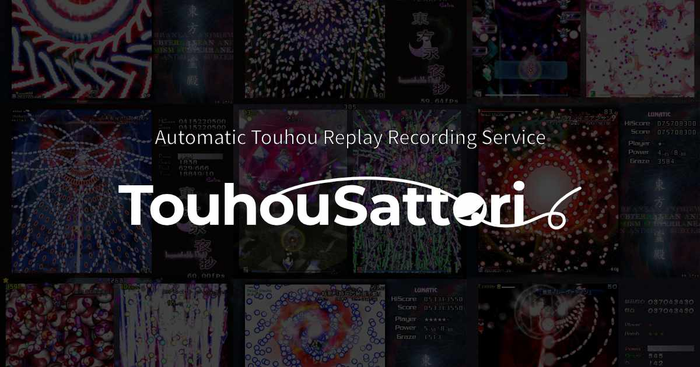

# TouhouSattori

**TouhouSattori is a free web service that automatically generates a recorded video from a Touhou Project replay file — just upload the replay.**

Our goal is to let fans of the original Touhou games create replay videos with ease, without any knowledge of video files or tedious processing, and to upload them to video sites with minimal effort.

## Current Status

After its initial release on 2026-08-22, we have been steadily adding features and expanding the list of supported titles.

### Supported Titles

* Embodiment of Scarlet Devil (th06)
* Embodiment of Scarlet Devil: Classic (th06c)
* Embodiment of Scarlet Devil: New Classic (th06nc)
* Perfect Cherry Blossom (th07)
* Imperishable Night (th08)
* Phantasmagoria of Flower View (th09)
* Mountain of Faith (th10)
* Subterranean Animism (th11)
* Undefined Fantastic Object (th12)
* Fairy Wars (th128)
* Ten Desires (th13)
* Double Dealing Character (th14)
* Legacy of Lunatic Kingdom (th15)
* Fossilized Wonders (th20)

## License / Disclaimer

The source code of this repository is released under the [MIT License](./LICENSE).

Touhou Project is the copyrighted work of Team Shanghai Alice. This project is a fan-made, unofficial service and is not affiliated with Team Shanghai Alice. The repository does not contain any copyrighted material such as the games themselves, code, or assets.
