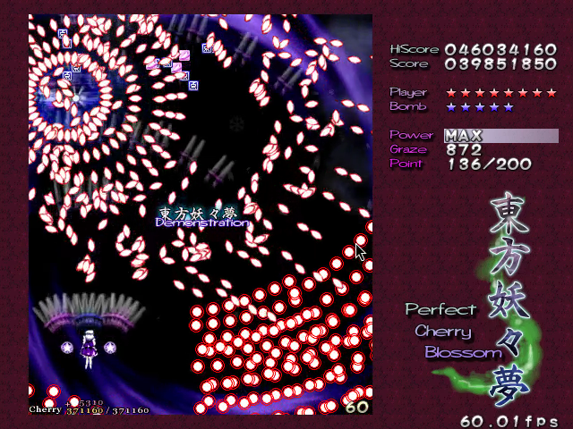

# フェーズ2: Xvfbヘッドレス録画の成功(th07)

日付: 2026-07-14

## 背景

th06(D3D8)はwined3dで白画面のまま無限ループするハングを確認した(`01_phase1_th06_baseline.md`参照)。ユーザーとの相談の結果、GPUプレゼンテーション(DXVK/Vulkan)の問題は一旦棚上げし、**ソフトウェアレンダリング(llvmpipe/lavapipe)を前提に先に進む**方針とした。th06固有の問題かwined3d全般の問題かを切り分けるため、同じD3D8エンジンのth07で試した。

## 結果: th07はXvfb + wined3d(llvmpipe)で完全に正常動作

- `Xvfb :90 -screen 0 800x600x24` を起動(拡張: BIG-REQUESTS, Composite, DAMAGE, GLX, Present, RANDR等。**DRI3は無し**)
- `WINEPREFIX=prefixes/th07-wined3d-gl`(32bit)でth07.exeを起動
- ウィンドウ「東方妖々夢　～ Perfect Cherry Blossom. ver 1.00」が640x480で正常に出現
- タイトル画面の自動デモ(アトラクトモード)が **完全に正しく描画される**:スコア・HiScore・残機・ボム・Power・Graze・Point・弾幕パターンすべて正常
- **ゲーム内蔵のfpsカウンターが59.96〜60.01fpsで安定**(複数回のスクリーンショットで確認)
- `ffmpeg -f x11grab -framerate 60` で15秒間録画したところ、**900フレーム(60fps×15秒)ちょうど**が記録され、キャプチャ側の速度も最終的に `speed=1x`(リアルタイム追従)を達成
- 録画動画の先頭・中間・末尾フレームを静止画抽出して目視確認。**全フレームで弾幕・UI・fpsカウンターが破綻なく描画されていた**

## 結論・示唆

- **th06のwined3dハングはth06固有の問題であり、wined3d/Xvfb/ソフトウェアレンダリングの組み合わせ自体は問題なく機能する**ことが実証された
- ソフトウェアレンダリング(llvmpipe)でも640x480程度の解像度であれば60fps安定動作は十分可能であることが確認できた。GPU/DXVK/DRI3問題を今すぐ解決する必要性は薄れた
- CPU使用率は th07.exe 単体で約137%(マルチスレッドllvmpipeのため)。これはフェーズ5(並列実行数の上限検討)で重要な数値になる

## 次のステップ

今回はゲーム内蔵の「アトラクトモード自動デモ」の描画確認に留まった。フェーズ3の本題である「実際の.rpyリプレイファイルの自動再生」に進むには、タイトル画面からリプレイメニューをxdotoolでキー操作しナビゲートする仕組みが必要。th06のwined3dハングの原因調査は保留とし、まずth07で実リプレイ自動再生の仕組みを構築する。
