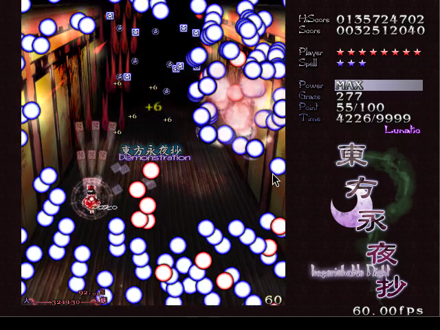

# フェーズ4(再定義): D3D9タイトルでのソフトウェアレンダリング検証 + th13のSteam DRM問題

日付: 2026-07-15

## 背景

当初のフェーズ4は「GPUレンダリング vs ソフトウェアレンダリング」の比較を想定していたが、Xvfb環境では`vulkaninfo`自体が「No DRI3 support detected - required for presentation」と報告する通り、**Vulkan(DXVK)によるウィンドウへのプレゼンテーションがそもそも成立しない**ことが既に判明している。またwined3d(GLX)側もXvfb起動時に`amdgpu_query_info(ACCEL_WORKING) failed`となり実GPUは使えず、software(llvmpipe)以外の選択肢が無い。

そのため、フェーズ4は「**D3D9世代のより複雑な描画を持つタイトルでも、ソフトウェアレンダリングで60fps相当を維持できるか**」という問いに読み替えて検証した。

## th13(神霊廟)はSteamのDRMチェックで起動できず

- th13.exeを起動すると、ウィンドウが一切出現せず、**exit code 53で即座に正常終了**する
- `WINEDEBUG=+module`でトレースしたところ、起動直後に`steamclient.dll`のハンドル取得を試み、見つからない(`-> 00000000`)ことを確認。その直後、ウィンドウ作成やDirectX初期化に一切進まないまま、全スレッドがクリーンにTHREAD_DETACH/PROCESS_DETACHしてプロセスが終了している(クラッシュではなく、意図的な終了と考えられる)
- th13のゲームフォルダには`steam_api.dll`や`steam_appid.txt`が存在せず、Steam版として抽出されたファイル一式に**Steam連携用DLLが同梱されていない**ことが原因と推測される
- th08/th11/th14/th15/th20のフォルダにもsteam関連ファイルは無いが、後述の通りth08は問題なく起動できており、この問題はth13固有(またはSteam版として抽出された特定タイトル固有)の可能性が高い

## th08(永夜抄、D3D9)はXvfb + wined3d(llvmpipe)で完全に正常動作

- ウィンドウ「東方永夜抄　～ Imperishable Night. ver 1.00a」が640x480で正常に出現
- タイトル画面の自動デモが完全に正しく描画される:スコア・HiScore・残機・Spell・Power・Graze・Point・Time・弾幕パターンすべて正常
- **ゲーム内蔵fpsカウンターが60.00fpsで安定**
- ffmpegで15秒間録画し、900フレーム(60fps×15秒)ちょうどを記録、`speed=1x`でリアルタイム追従を達成。最終フレームでも60.00fps・弾幕描画とも破綻なし

## 結論

- **D3D8(th07)だけでなくD3D9(th08)でも、Xvfb + wined3d(llvmpipe)ソフトウェアレンダリングで60fps安定動作が可能**であることを確認した。実GPU/DXVKが使えないXvfb環境でも、PoCの核心である「60fps安定動作」自体は成立する見込みが高い
- th13はゲーム固有のSteam DRMチェックにより起動不可。これは環境側の問題ではなく、該当タイトルのファイル一式にSteam連携ファイルが欠けていることが原因と考えられる。対処(steam_api.dllの補完、steam_appid.txtの設置、または該当タイトルを非Steam版に差し替える等)は別途検討が必要な既知の課題として記録し、th14/th15/th20で同様の問題が起きるかは今後確認する
