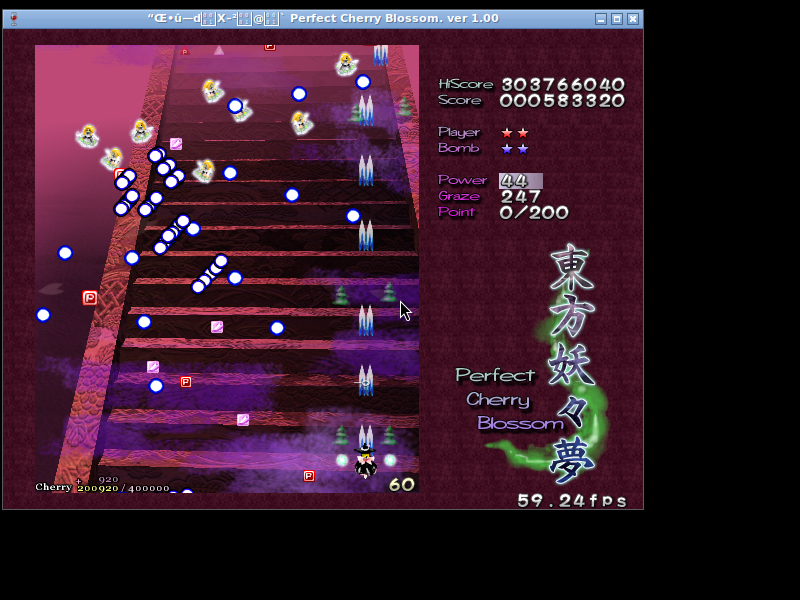
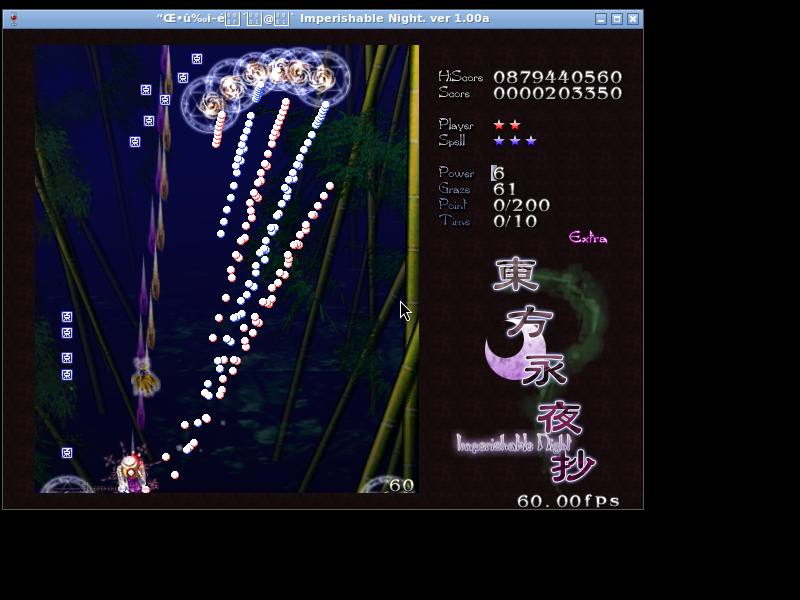

# フェーズ9: Windows実機開発MODのLinux/Wine環境での動作検証

日付: 2026-07-15

## 背景

`reports/07_phase7_*.md`・`reports/08_phase8_*.md`でWindows実機上で開発・検証したth07/th08向けリプレイ自動再生MOD(`mods/`)一式を、本PoCの本番想定環境であるLinux(Wine + Xvfb)にコピーしてもらい、そのまま動作するかを検証した。`reports/06_replay_automation_mod_feasibility.md`のitem 6で「他タイトルへの適用やLinux/Wine環境でのDLLインジェクション自体の検証はまだ行っていない」としていた残課題への対応。

## 検証環境

- `mods/common/build/injector.exe`, `mods/th07_replay_autoplay/build/th07_hook.dll`, `mods/th08_replay_autoplay/build/th08_hook.dll`(いずれもWindows上でMSVCビルド済みのPE32 32bitバイナリ、`file`コマンドで確認)をそのまま流用(Linux側での再ビルドは行っていない)
- `Xvfb :95/:96 -screen 0 800x600x24` + `openbox --sm-disable`
- `WINEPREFIX=prefixes/th07-wined3d-gl` / `prefixes/th08-wined3d-gl`(いずれもフェーズ2・4で60fps動作実績済みのプレフィックス)
- インジェクション方法: `wine injector.exe <th0X.exe> <th0X_hook.dll>` (Windows実機と同一のコマンド)

## 結果: 追加の変更なしでフックチェーン自体は完全に動作した

`mods/common/injector.cpp`(`CreateProcess(SUSPENDED)`→`WriteProcessMemory`→`CreateRemoteThread(LoadLibraryA)`→`ResumeThread`)、および`mods/common/dinput_hook.cpp`のIAT→vtable[3]→vtable[9]の3段フックは、**Wine 9.0上でもソースコード・バイナリともに一切変更せず動作した**。th07のログ:

```
DirectInput8Create: hooked CreateDevice (vtable[3])
CreateDevice: hooked GetDeviceState (vtable[9])
WaitForStableWindow: stable after 3172 ms total
WaitForHookActive: GetDeviceState hook active after 0 ms (count=81)
...
=== th07_replay_autoplay: sequence complete ===
```

## 発見した環境固有の問題: th08のフルスクリーン設定によるハング

th08への初回注入テストで、**ウィンドウが一切表示されず(またはXvfb画面が真っ黒のまま)プロセスが応答しなくなる**現象が発生した。DLLを外してTH08.EXE単体で起動しても同様に再現し、**本MODとは無関係のtitleそのものの起動問題**と判明した。

wineの標準エラー出力を確認したところ、以下が大量に出力され続けていた:

```
err:system:NtUserChangeDisplaySettings Changing L"\\.\DISPLAY1" display settings returned -2.
```

原因は`games/th08/TH08.CFG`が**フルスクリーンモード**に設定されていたこと。DRI3非対応のXvfbでは、フルスクリーン化に伴う`ChangeDisplaySettings`相当のディスプレイモード変更が失敗し続け、ゲームがその失敗を無限にリトライしてハングする(`AGENTS.md`に記録されている「3インスタンス以上での`NtUserChangeDisplaySettings`無限リトライ」と同一のエラーだが、**今回は単一インスタンスでもフルスクリーン設定さえしていれば発生する**ことが分かった。並列数の問題ではなく、フルスクリーン化そのものがXvfb環境と相性が悪いことが真因だったと考えられる)。

### 対処

`TH08.CFG`の該当バイト(オフセット`0x22`)を`00`(ウィンドウモード)に書き換えた(ユーザーが手動で修正)ところ、直ちにタイトル画面が正常表示され、以降MODのインジェクション・キーシーケンスとも問題なく動作した。th07は元々ウィンドウモード設定だったため、この問題には遭遇しなかった。

**示唆**: 今後th11以降の他タイトルにMODを移植する際は、事前に対象タイトルの`.cfg`がウィンドウモードになっていることを確認すべき(`AGENTS.md`に追記した)。

## 再現性確認

修正後、th07・th08それぞれ3回連続でクリーンな注入→キーシーケンス完走を確認した(3/3回成功、いずれも`sequence complete`ログと、スクリーンショットによるリプレイ再生画面到達を確認)。

- th07: `HiScore 303766040` → 数秒後に `Score 000583320`、Graze加算、弾幕描画が進行(スペルカード「妖怪の式の式」)
- th08: `HiScore 0879440560` → `Score 0000203350`、竹林ステージの弾幕描画、60.00fps表示

 

## 結論

- Windows実機で確立したDLLインジェクションMOD(バイナリ・ソース双方)は、**Wine 9.0 + Xvfb環境でも無修正でそのまま動作する**ことを実証した(`reports/06_*.md`item 6の残課題を解消)
- th08で発見した「フルスクリーン設定によるXvfb上でのハング」は、MOD固有の問題ではなく**対象ゲームの表示モード設定に起因する環境要因**であり、他タイトルへの展開時にも同様のチェックが必要な既知の落とし穴として記録した
- これにより、当初の課題(`03_phase3_input_reliability.md`のxdotool方式の信頼性不足)は、th07・th08について**Linux/Wineの本番想定環境で完全に解決された**と言える

## 次のアクション

- 他タイトル(th11以降)へのMOD移植時は、`.cfg`のウィンドウモード確認を事前に行う
- ffmpegによる録画を組み合わせ、実際にデシンクなく60fps録画できるかの検証(フェーズ3の本題であった「デシンクの有無判定」)に進む
