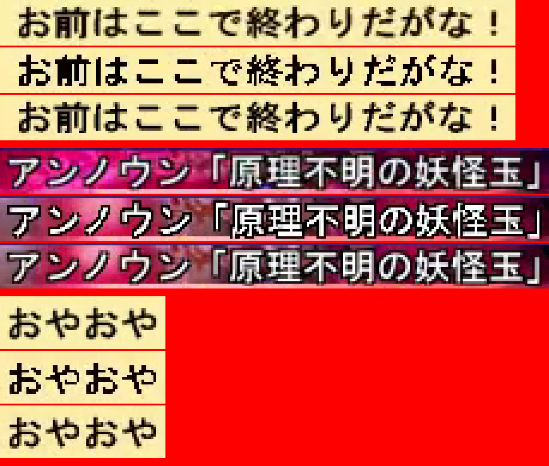
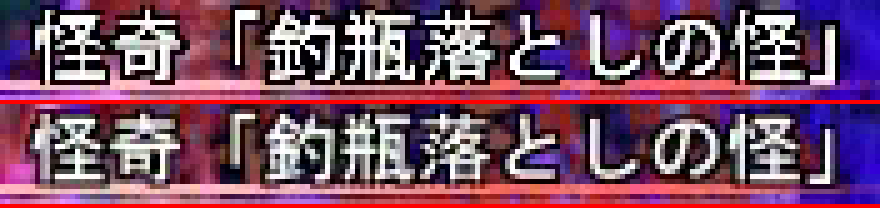
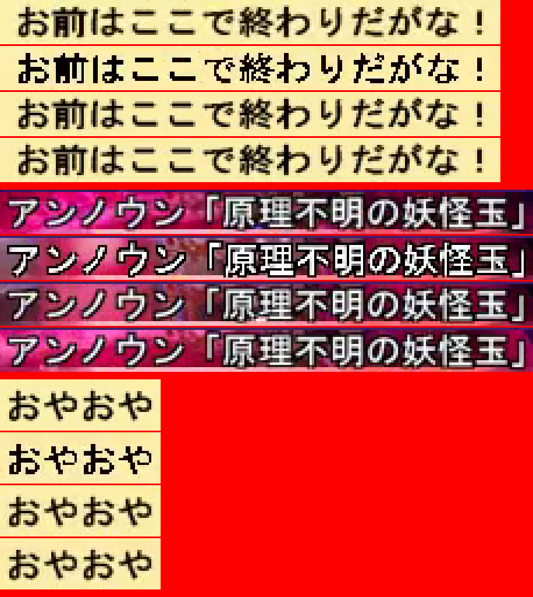
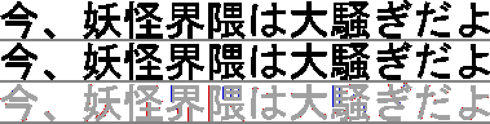
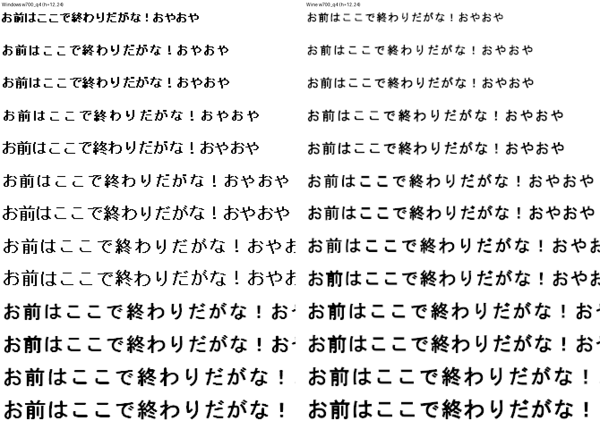

# フェーズ101: 日本語テキストのジャギーの再調査(原因はd3dx9の縮小フィルタ)

日付: 2026-11-12

## 結論

- **ジャギーの原因はフォント描画(GDI/FreeType)ではなく、Wine の d3dx9 が `D3DXLoadSurfaceFromMemory` の縮小フィルタ(`D3DX_FILTER_TRIANGLE`)を実装しておらず、常に最近傍(point)で間引いていること**だった。
  - th13 は会話文・スペルカード名を GDI で **2 倍の大きさ(MS ゴシック height=32)** に 1024 幅の 16bpp DIB へ描き、`D3DXLoadSurfaceFromMemory(..., srcRect=1024x44 → dstRect=512x20, Filter=D3DX_FILTER_TRIANGLE)` でテクスチャへ縮小転送している。
  - DIB 上の文字の形は**アルファの 0/F の二値**にしか残らない(後述)。Windows のネイティブ d3dx9 はこれを TRIANGLE フィルタで平均して縁に中間階調を作るが、Wine は最近傍で間引くので二値のまま表示される。
- フェーズ38・39の「Wine の FreeType の AA が粗い」という推定は誤りだった。GDI の AA は Wine でも効いているが、ゲームの描き方では AA の結果がどのみち捨てられる。
- **対策(実証済み)**: MOD で `D3DXLoadSurfaceFromMemory` を IAT フックし、縮小を伴う呼び出しを MOD 側で縮小してから `D3DX_FILTER_NONE` で Wine の d3dx9 に渡す(`mods/common/d3dx_filter_hook.*`、環境変数 `D3DX_AREA_FILTER=1`)。th13 の 3 場面で Windows 実機とほぼ同じ見た目になった(下図・数値)。縮小カーネルは当初の面積平均から、ネイティブ d3dx9 の出力に合わせた「半径 0.8×縮小率のテント」に改めた(8節)。
- **案B(ネイティブ d3dx9)も検証した**: Microsoft の `d3dx9_43.dll` を Wine で読み込ませると、Windows 実機とほぼ同じ見た目になった。原因の裏付けになる。MOD 側のテント縮小の出力は、このネイティブ DLL の出力と 4bit アルファで 97.1〜98.4% 一致し、残りもすべて 1 段階以内(8節)。
- **Windows 実機でも裏付けた(9節)**: Windows の GDI も DIB を二値にしか書かず、Windows の `d3dx9_43.dll` は同じ入力に対して Linux の「Wine + ネイティブ DLL」と画素単位で同じ出力を返した。テント縮小は Windows のネイティブ出力とも 96〜98.5% 一致(全画素 1 段階以内)。Windows 実機の画面と比べて残る差は、主に GDI の字形の違い(Windows の方が書く画素が 2〜4% 多い)によるもので、縮小方式では詰められない。
- **本番には案Aを推す(10節)**: 改良後の案Aは文字の転送 1 回 0.29ms で現行(0.32ms)と同じ負荷で、CPU を 4 スレッドまで絞っても録画品質(落ち率・FpsMonitor)は現行と差が無かった。案Bは d3dx9 全体ではわずかに軽いが、会話の開始時の転送が 4 倍重く 1 フレームに集中する。
- 同じ経路(`D3DXLoadSurfaceFromMemory` + GDI `TextOutA`)は th10・th11・th12・th128・th13・th15 にある。フックはこの 6 タイトルの MOD に組み込んだ(既定では無効、環境変数で有効化)。



各組は上から Windows 実機(ユーザー提供)、Wine(現行)、Wine + `D3DX_AREA_FILTER=1`。4 倍に最近傍拡大。組は上から 69s(会話)、116s(スペルカード名、縁取りあり)、202s(会話)。

## 1. 調査の流れ

### 1.1 GDI/FreeType 側の再確認(原因ではなかった)

Wine 9.0 のソース(`dlls/win32u/freetype.c`)を読み直した。

- `freetype_get_glyph_outline()` は `format == GGO_BITMAP`(二値)のときだけ埋め込みビットマップ(EBDT)を使う(`if (matrices || format != GGO_BITMAP) load_flags |= FT_LOAD_NO_BITMAP;`、3469行)。
- `freetype_get_aa_flags()` は、`ANTIALIASED_QUALITY` を明示していても、gasp に `GASP_DOGRAY` の無い ppem では `GGO_BITMAP` へ格下げする。ただし疑似ボールド・斜体は `AntialiasFakeBoldOrItalic`(既定 TRUE)で除外(2483行)。
- MS ゴシック(msgothic.ttc)は 7〜22ppem に埋め込みビットマップを持ち、gasp は `{9: 9, 20: 5, 65535: 11}`(9〜20ppem は DOGRAY なし)。

最小の GDI テスト(`scripts/101_font_aa/gdi_text_test.cpp`、白地に黒で `TextOutW`)を th13 の WINEPREFIX の複製で実行した結果:

| 条件 | height 12〜20 | height 21〜32 |
|---|---|---|
| MS ゴシック weight 400 `ANTIALIASED_QUALITY` | 2 階調(二値、`WINEDEBUG=+font` に `aa disabled by GASP`) | 16 階調(AA) |
| 同 weight 700(疑似ボールド) | 16 階調 | 16 階調 |
| weight 400 + gasp 全レンジに DOGRAY(`scripts/101_patch_gasp_dogray.py`) | 16 階調 | 16 階調 |

ここまでは「小さい MS ゴシックが二値になる」経路があるように見えた。しかし th13 の実際の呼び出しを記録すると(1.2)、使われているのは height=32(DOGRAY 範囲内)と height=15・weight 700(疑似ボールド)で、**どちらもこの格下げに当たらない**。gasp の書き換えは th13 には効かない(フェーズ39で th11 に効かなかったのと同じ)。

### 1.2 th13 の実際の描画経路

`mods/common/font_quality_hook.*` を拡張し、`CreateFontA` に加えて `TextOutA`(文字列・選択中のフォント・文字色・背景モード・描画先のビット深度)と `CreateDIBSection`(サイズ・ビット深度・ビットマスク)も記録するようにした(`FONT_QUALITY_PROBE=1`)。`FONT_PROBE_DUMP_DIR` を指定すると、`TextOutA` の直前・直後の DIB の中身もファイルに書き出す。

```
CreateDIBSection: 1024x-129 bpp=16 compression=3 masks=00000F00,000000F0,0000000F
TextOutA: (0,2) h=32 w=400 q=4 color=000000 bkmode=1 bpp=16 text='お前はここで終わりだがな！'
TextOutA: (194,4) h=32 w=400 q=4 color=000000 bkmode=1 bpp=16 text='アンノウン「軌道不明の鬼火」'   (縁取り用に4方向ずらして描く)
```

215 秒の録画中の `TextOutA` は h=32・w400 が 126 回、h=32・白(縁取りの中身)が 4 回、h=15・w700 が 5 回。

DIB の中身(ダンプ)を見ると:

- 描画前: 文字を置く範囲が `0xF000`(上位 4bit=F、RGB=0)、それ以外が `0x0000`。
- 描画後: 文字の画素が `0xF000 → 0x0000` に変わるだけで、**中間値は 1 つも無い**。

ビットマスクが R=0x0F00・G=0x00F0・B=0x000F なので、上位 4bit(0xF000)はどの色にも属さない。ゲームはこの DIB を A4R4G4B4 として扱い、上位 4bit をアルファにしている。GDI は文字を書いた画素の上位ビットを 0 にするので、**文字の形は「GDI が書いた/書かなかった」の 1bit としてアルファに残る**。RGB は背景も文字も黒なので、AA で混ぜても値は変わらない。GDI の AA の有無は最終結果に関係しない(Windows でも同じ仕組みのはずで、Windows 実機の DIB ダンプによる確認は未実施。5節)。

### 1.3 縮小転送

`mods/common/d3dx_filter_hook.*` を新規作成し、`D3DXLoadSurfaceFromMemory`/`D3DXLoadSurfaceFromSurface` の引数を記録した(`D3DX_LOAD_PROBE=1`)。

```
D3DXLoadSurfaceFromMemory: dst=512x512/A4R4G4B4 rect=(0,1)-(512,21) src=A4R4G4B4 pitch=2048 rect=(0,0)-(1024,44) filter=0x4 colorkey=0
D3DXLoadSurfaceFromMemory: dst=512x512/A4R4G4B4 rect=(0,92)-(320,109) src=A4R4G4B4 pitch=2048 rect=(0,0)-(662,36) filter=0x4 colorkey=0
```

文字列の転送だけが拡大縮小付き(横 1/2・縦 1/2.2、`filter=0x4`=`D3DX_FILTER_TRIANGLE`)で、他のテクスチャ転送はすべて等倍・`D3DX_FILTER_NONE`。描画時のサンプラーは MIN/MAG とも `D3DTEXF_POINT`(`D3D9_PROBE=1` の記録で `filt=1/1`)なので、GPU 側では平滑化されない。表示上の平滑化は、この CPU 側の縮小で決まる。

Wine 9.0 の `dlls/d3dx9_36/surface.c`(2111〜2122行):

```c
else /* if ((filter & 0xf) == D3DX_FILTER_POINT) */
{
    if ((filter & 0xf) != D3DX_FILTER_POINT)
        FIXME("Unhandled filter %#lx.\n", filter);
    /* Always apply a point filter until D3DX_FILTER_LINEAR,
     * D3DX_FILTER_TRIANGLE and D3DX_FILTER_BOX are implemented. */
```

Wine master(2026-11 時点、wine-11.21、`dlls/d3dx9_36/d3dx_helpers.c` 3257〜3378行)では BOX だけが実装されたが、それも「ちょうど 1/2 かつ 2 のべき乗」のときに限られ、TRIANGLE は今も最近傍。**Wine を更新しても直らない。**

DIB ダンプの二値アルファをオフラインで縮小したシミュレーションでも、最近傍は Wine の録画と、面積平均は Windows 実機と同じ見た目になった。

## 2. 対策

### 2.1 採用案: MOD 側での面積平均(`D3DX_AREA_FILTER=1`)

`mods/common/d3dx_filter_hook.cpp` の `My_LoadFromMemory()`:

1. 転送元と転送先の矩形のサイズが違い(縮小のみ。拡大は対象外)、フィルタが LINEAR/TRIANGLE/BOX(`D3DX_DEFAULT` を含む)、ミラー指定・パレット無し、転送元の形式が対応済み(A8R8G8B8・X8R8G8B8・R5G6B5・X1R5G5B5・A1R5G5B5・A4R4G4B4・X4R4G4B4・A8)の場合だけ処理する。
2. 転送元を ARGB8888 に展開し(カラーキー一致は透明な黒に置換)、縦横に分離した重み付き平均で縮小する(`AreaResample()`。チャンネル独立・非乗算済み。D3DX の BOX/TRIANGLE と同じ扱い)。重みは `D3DX_AREA_FILTER_RADIUS`(既定 0.8)で決まり、既定は中心 (o+0.5)×s・半径 0.8×s(s は縮小率)のテントを各転送元画素の範囲で積分したもの。0 にすると、当初の面積平均(出力画素の範囲との重なり)になる。転送先が A4R4G4B4/X4R4G4B4 なら各チャンネルを 17 の倍数に四捨五入する(Wine の d3dx9 は A8R8G8B8→A4R4G4B4 の変換で下位を切り捨てるため)。
3. 転送先と同じサイズの A8R8G8B8 バッファを、`D3DX_FILTER_NONE` で元の `D3DXLoadSurfaceFromMemory` に渡す(A4R4G4B4 への変換は Wine の d3dx9 が行う)。

`HookIAT()` は `d3dx9_` で始まる名前の DLL を対象にする(th10 は `d3dx9_31.dll`、th11 は `d3dx9_37.dll`、th12 は `d3dx9_40.dll`、th128 は `d3dx9_42.dll`、th13・th15 は `d3dx9_43.dll`)。

### 2.2 th13 での効果(215 秒録画、`scripts/101_font_aa/compare_crops.py`、面積平均版)

(テント版・ネイティブ d3dx9 の数値は8節。)

参照スクリーンショットと同じ場面のフレームを ±4 秒から探し、指定矩形で比較した。「中間階調率」はクロップ内の輝度 48〜207 の画素の割合。

| 場面 | Windows との平均絶対差: 現行 → 面積平均 | 中間階調率: Windows / 現行 / 面積平均 |
|---|---|---|
| 69s 会話 | 24.4 → **7.9** | 0.177 / 0.000 / 0.142 |
| 116s スペルカード名(背景が動くため差は大きめ) | 49.8 → **18.1** | 0.533 / 0.492 / 0.597 |
| 202s 会話 | 20.4 → **5.3** | 0.138 / 0.000 / 0.123 |

文字の位置ずれも無い(±2px のずらし探索で dx=dy=0 が最小)。なお、ユーザー提供の `th13_06_wine_69s_crop.png` だけは指定座標より 1px 下(y=282)から切り出されていた。比較ではフル画面のスクリーンショットを指定座標で切り出したものを基準にしている。

**フル尺(ローカル Xvfb、等倍、`D3DX_AREA_FILTER=1`)**: th13_06.rpy(Extra、45906 フレーム)を試行 1 回で完走。総録画 801.9 秒、画面静止検知で終了。最終スコア 11716879×10 = **117,168,790 でリプレイ記録と一致**。同期マーカー残差 −0.8ms、録画開始 15 秒以降の重複フレーム率 0.4%。フックは文字列の更新時(1024x44 を 1 回縮小)にしか動かないため、録画速度への影響は無視できる。動画は `/mnt/cache3/sattori-th13-verify/101/areafilter_full.mp4`(視聴確認はまだ)。

### 2.3 検討したが採用しなかった案

| 案 | 内容 | 判断 |
|---|---|---|
| B: ネイティブ d3dx9 | Microsoft の DirectX 再頒布パッケージ(June 2010)の `d3dx9_43.dll` を `WINEDLLOVERRIDES=d3dx9_43=n,b` で使う(winetricks の `d3dx9_43` と同じ) | **効果あり(8節)**。Windows との差は最小。ただしタイトルごとに `d3dx9_31`〜`_43` が必要で、本番の Docker イメージに Microsoft の再頒布物を入れる扱いの確認が要る。d3dx9 全体が置き換わるため、文字以外の描画への影響も確かめる必要がある。案A(テント)で実質同じ結果になるため、本番には案Aを推す |
| C: Wine 本体に TRIANGLE を実装 | `d3dx_load_pixels_from_pixels()` に TRIANGLE/LINEAR を実装する(upstream への貢献) | 本筋だが、自前ビルドの Wine を本番に入れる負担が大きい。案Aで同じ結果になる |
| D: gasp の書き換え | msgothic.ttc の gasp に DOGRAY を立てる | th13 の文字は gasp の格下げに当たらないため効果なし(1.1) |
| E: lfQuality の書き換え | `FONT_QUALITY_OVERRIDE` | GDI の AA の結果は DIB に残らないため効果なし(1.2) |
| F: テクスチャのサンプラーを LINEAR にする | 描画時のフィルタを変える | 縮小後のテクスチャがすでに二値なので効果なし。他の描画にも影響する |

## 3. 他タイトル

`i686-w64-mingw32-objdump -p` の import:

| タイトル | d3dx9 | `D3DXLoadSurfaceFromMemory` | GDI `CreateFontA`+`TextOutA` |
|---|---|---|---|
| th06〜th09 | なし(D3D8) | なし | あり |
| th10 | d3dx9_31 | あり | あり |
| th11 | d3dx9_37 | あり | あり |
| th12 | d3dx9_40 | あり | あり |
| th128 | d3dx9_42 | あり | あり |
| th13 | d3dx9_43 | あり | あり |
| th15 | d3dx9_43 | あり | あり |
| th20 | d3dx9_43 | なし | あり |

th10・th11・th12・th128・th15 の MOD にも `InstallD3DXFilterHook()` を組み込んだ(既定は無効)。

### th11 での確認(フェーズ38・39の対象)

既定のリプレイを 240 秒、`D3DX_LOAD_PROBE=1` で通常版・`D3DX_AREA_FILTER=1` 版の 2 本録画した(`/mnt/cache3/sattori-th11-verify/101/{base,area}240.mp4`)。th11 も同じ経路だった。

```
D3DXLoadSurfaceFromMemory: dst=512x512/A4R4G4B4 rect=(0,1)-(354,18) src=A4R4G4B4 pitch=2048 rect=(0,0)-(730,36) filter=0x4 colorkey=0
```

(730x36 → 354x17、`D3DX_FILTER_TRIANGLE`。会話の 4 行が y=1・19・37・55 に並ぶ。)録画 64 秒地点のスペルカード名(上: 現行、下: 面積平均、5 倍拡大):



フェーズ39の画素値比較で「Wine は 3〜4px で急峻に遷移し 0/255 が多い」としていたのは、GDI の AA の粗さではなく、二値アルファを最近傍で縮小した結果だったと考えられる。th11 の Windows 実機との画素比較(Music Room のスクリーンショット)と、th10・th12・th128・th15 での見た目の確認はしていない(import が同じで、フックは組み込み済み)。

## 4. 変更ファイル

- `mods/common/d3dx_filter_hook.h/.cpp`(新規): `D3DXLoadSurfaceFromMemory` の記録(`D3DX_LOAD_PROBE=1`)、テント/面積平均による縮小(`D3DX_AREA_FILTER=1`、`D3DX_AREA_FILTER_RADIUS`)、転送の前後のダンプ(`D3DX_DUMP_DIR`)
- `mods/common/font_quality_hook.cpp`: CP932 のフォント名を UTF-8 に変換してログに書く(生の CP932 だと recorder のログ読み込みが `UnicodeDecodeError` で止まった)。`TextOutA`・`CreateDIBSection` の記録と DIB ダンプ(`FONT_PROBE_DUMP_DIR`)を追加
- `mods/common/build_mingw.sh`: `-lgdi32` を追加(上記の記録で GDI の関数を呼ぶため)
- `mods/th13_replay_autoplay/dllmain.cpp`: `FONT_QUALITY_PROBE`/`FONT_QUALITY_OVERRIDE`、`D3D9_PROBE`、`InstallD3DXFilterHook()` を追加(すべて環境変数で有効化)
- `mods/{th10,th11,th12,th128,th15}_replay_autoplay/dllmain.cpp`: `InstallD3DXFilterHook()` を追加
- `scripts/101_font_aa/gdi_text_test.cpp`: GDI テキスト描画の最小テスト(`i686-w64-mingw32-g++ -O2 -static -municode -finput-charset=UTF-8 -o gdi_text_test.exe gdi_text_test.cpp -lgdi32`)
- `scripts/101_font_aa/compare_crops.py`: 参照スクリーンショットとの比較
- `scripts/101_font_aa/compare_xfer_dumps.py`: `D3DX_DUMP_DIR` のダンプ 2 組の比較(転送元が同じ転送どうしで、転送先のアルファを比べる)
- `scripts/101_font_aa/analyze_dib_dumps.py`: `FONT_PROBE_DUMP_DIR` のダンプの解析
- `scripts/101_font_aa/analyze_gdi_pgm.py`: `gdi_text_test.exe` の出力の階調数の要約
- `scripts/101_font_aa/WINDOWS_AGENT_PROMPT.md`: Windows 実機での追加検証を別のエージェントに頼むためのプロンプト(6節)
- `scripts/101_patch_gasp_dogray.py`: gasp 書き換え(案D、効果なし)

## 5. 再現手順

```bash
# 現行(ジャギーあり)と面積平均の 215 秒録画
python3 scripts/25_record_replay_e2e_multigame.py --game th13 --replay th13_06.rpy --record-seconds 215 \
  --output /mnt/cache3/sattori-th13-verify/101/baseline.mp4
D3DX_AREA_FILTER=1 python3 scripts/25_record_replay_e2e_multigame.py --game th13 --replay th13_06.rpy \
  --record-seconds 215 --output /mnt/cache3/sattori-th13-verify/101/areafilter.mp4
python3 scripts/101_font_aa/compare_crops.py /mnt/cache3/sattori-th13-verify/101/areafilter.mp4 /tmp/area

# 呼び出しの記録
FONT_QUALITY_PROBE=1 D3DX_LOAD_PROBE=1 python3 scripts/25_record_replay_e2e_multigame.py --game th13 \
  --replay th13_06.rpy --record-seconds 75 --output /mnt/cache3/sattori-th13-verify/101/probe.mp4
grep -a "TextOutA\|CreateDIBSection\|D3DXLoad" instances/th13-multigame-recording-test/th13_autoplay.log
```

## 6. Windows 実機での確認(依頼内容)

次の 3 点を、Windows 実機で動くエージェントに `scripts/101_font_aa/WINDOWS_AGENT_PROMPT.md` で依頼した。比べる相手の Linux 側のダンプは `runs/101_linux_dumps/`(gitignore 対象)に置いた。結果は9節。

1. **(A) DIB の二値性**: Windows の GDI でも、文字を描いた直後の DIB が `0xF000→0x0000` の二値になるか。
2. **(B) ネイティブ d3dx9 の出力**: Windows 実機の出力が Linux の「Wine + ネイティブ DLL」と同じか。テント縮小とどれだけ違うか。
3. **(C) gasp の扱い**: MS ゴシック weight 400・`ANTIALIASED_QUALITY`・height 12〜20 が Windows でも二値になるか。

## 7. 今後

- **本番で有効にするかの判断**: `D3DX_AREA_FILTER=1` は既定では無効にしてある。テント版のフル尺(8節)を視聴して問題なければ、th10〜th15 で既定を有効に切り替える(MOD 側で環境変数が未設定なら有効にするか、recorder から環境変数を渡す)。
- 半径 0.8 は、Windows 実機でも 1024x44→512x20・662x36→320x17 の両方で最良だった(9.2節)。th11(730x36→354x17)など他の縮小率でも、ネイティブと比べるとより確実になる。
- **GDI の字形の違い(9.1節)**: Windows の GDI は Wine より縁の画素を多く書く(文字がわずかに太い)。d3dx9 とは別の差で、今回の対策では残る。詰めるなら Wine のヒンティング・ラスタライズの設定を調べる必要がある(未着手)。
- **疑似ボールドの小さい MS ゴシック(9.3節)**: th13 は `ＭＳ ゴシック height=15 weight=700` で、何かの文字列を 1 文字ずつ描いている(Linux の記録で「バ」「ケ」「じ」「か」「ら」の 5 回。何の表示かは未特定)。Windows では二値の太字、Wine では AA の細字になる。Wine の `HKCU\Software\Wine\Fonts` の `AntialiasFakeBoldOrItalic="n"` で揃う可能性がある(未検証)。
- Wine upstream に `D3DX_FILTER_TRIANGLE` の実装を提案すれば、他の利用者にも効く。
- th06〜th09(D3D8)・th20 は別経路なので、文字のジャギーがあれば別途調べる。

## 8. 追加検証: 案B(ネイティブ d3dx9)とテント縮小

### 8.1 案B

`/mnt/cache3/sattori-th13-fontaa/dxredist/directx_Jun2010_redist.exe`(download.microsoft.com から取得、100,275,120 bytes、SHA-256 `053f76dc…c73b`。winetricks が記録しているミラーのハッシュとは異なるが、Microsoft の URL から直接取得した)から `Jun2010_d3dx9_43_x86.cab` → `d3dx9_43.dll`(2010-05-26)を `cabextract` で取り出し、インスタンスのディレクトリに一時的に置いて読み込ませた(録画後に削除済み。recorder のインスタンス準備は `rsync` に `--delete` が無いので、置いたファイルが残る)。

```bash
I=instances/th13-multigame-recording-test
cp /mnt/cache3/sattori-th13-fontaa/dxredist/x/d3dx9_43.dll $I/
WINEDLLOVERRIDES="d3dx9_43=n,b" D3DX_LOAD_PROBE=1 python3 scripts/25_record_replay_e2e_multigame.py --game th13 \
  --replay th13_06.rpy --record-seconds 215 --output /mnt/cache3/sattori-th13-verify/101/native_d3dx.mp4
rm -f $I/d3dx9_43.dll
```

録画は正常に終わった(重複フレーム率 0.7%)。

### 8.2 縮小結果の画素比較とカーネルの調整

`D3DX_DUMP_DIR` を追加し、拡大縮小を伴う転送の転送元と、転送後に `LockRect` で読み戻した転送先を書き出した(75 秒録画、ネイティブ・面積平均・テントの 3 通り。`/mnt/cache3/sattori-th13-verify/101/xfer_{native,area,tent}/`)。転送元が同じ 6 転送(うち 1 件は空)で、転送先の 4bit アルファを比べた(`scripts/101_font_aa/compare_xfer_dumps.py`):

| MOD 側の縮小 | ネイティブとの完全一致率 | 1 段階(17)以内 | 最大差 |
|---|---|---|---|
| 面積平均(当初) | 0.894〜0.917 | 0.994〜0.998 | 3 段階 |
| テント半径 0.8(採用) | **0.971〜0.984** | **1.000** | 1 段階 |

面積平均とネイティブを比べると、インクの総量(アルファの平均)はほぼ同じ(差 −0.22〜+0.15)だが、中間階調の画素はネイティブが約 1.5 倍多かった。つまりネイティブの TRIANGLE は、面積平均より広い範囲から混ぜている。転送元ダンプから Python でカーネルを総当たりした結果(4bit への丸め方も含む):

| カーネル | 丸め | 完全一致率 |
|---|---|---|
| 面積平均 | 切り捨て | 0.898(当初の C 実装の実測と一致。Wine の変換が切り捨て) |
| 面積平均 | 四捨五入 | 0.927 |
| テント 半径 0.70 / 0.75 / **0.80** / 0.85 / 0.90 ×s | 四捨五入 | 0.949 / 0.971 / **0.978** / 0.961 / 0.940 |
| テント 半径 1.0 / 1.25 ×s | 四捨五入 | 0.881 / 0.821 |

これに合わせて `AreaResample()` をテント(半径 0.8×s、縦横分離)+ 4bit への四捨五入に改め、C 実装の実測でも上表(0.971〜0.984)を確認した。

### 8.3 画面での比較(215 秒録画、`compare_crops.py`)

| 場面 | Windows との平均絶対差: 現行 / 面積平均 / テント / ネイティブ | 中間階調率: Windows / テント / ネイティブ |
|---|---|---|
| 69s 会話 | 24.4 / 7.9 / **6.1** / 5.6 | 0.177 / 0.174 / 0.165 |
| 116s スペルカード名 | 49.8 / 18.1 / **16.4** / 14.9 | 0.533 / 0.618 / 0.602 |
| 202s 会話 | 20.4 / 5.3 / **5.0** / 4.3 | 0.138 / 0.150 / 0.148 |



各組は上から Windows 実機、Wine(現行)、Wine + ネイティブ d3dx9、Wine + テント縮小。テントとネイティブの画面上の差は、転送結果の差(1 段階以内)より、録画のエンコードや取り出したフレームの違いの方が大きいと見られる。

### 8.4 フル尺(テント版)

`D3DX_AREA_FILTER=1`(半径 0.8 既定)で th13_06.rpy(Extra)をローカル Xvfb・等倍でフル尺録画した(`/mnt/cache3/sattori-th13-verify/101/tent_full.mp4`)。試行 1 回で完走、総録画 803.8 秒、最終スコア 11716879×10 = **117,168,790 でリプレイ記録と一致**、同期マーカー残差 −0.1ms、録画開始 15 秒以降の重複フレーム率 1.1%。視聴確認はまだ。

## 9. Windows 実機での検証結果

依頼(6節)の結果が届いた。原本は `scripts/101_font_aa/windows/RESULT.md`(生データは `runs/101_windows/`、gitignore 対象)。主な数値は、こちらで同じスクリプトを走らせて再現できることを確かめた。

環境: Windows 11 Home 26H2(ビルド 26340.9767)、RTX 5070、`C:\Windows\SysWOW64\d3dx9_43.dll` 9.29.952.3111(1,998,168 bytes、2010-05-26。案Bで使った June 2010 再頒布物と同じ版)、ClearType 有効。msgothic.ttc は fontRevision 5.32、gasp は Linux と同じ。MOD は Linux でビルドした `th13_hook.dll` をそのまま `injector.exe` で注入した。

途中で 1 点つまずいていた。エージェントのシェル(バックグラウンド)から起動すると、Windows のフォーカス奪取防止でゲームのウィンドウが前面に来ない。その結果 DirectInput の入力が届かず、MOD の自動操作が効かずにデモプレイが流れた。Alt キーを送ってから `SetForegroundWindow` で前面にし、5 秒ごとに前面を保つことで解決している。Windows 実機で MOD を使うときの注意点として残しておく。

### 9.1 (A) DIB は Windows でも二値

`FONT_QUALITY_PROBE=1`・`FONT_PROBE_DUMP_DIR` のダンプを `analyze_dib_dumps.py` で解析した。Windows でも、描画後の値は `0xf000 → 0x0` だけで、中間値は無かった。ログの `CreateDIBSection`(1024x-129、マスク 0x0F00/0x00F0/0x000F)・`CreateFontA`・`TextOutA` の引数も Wine と同じ。**GDI の AA の階調は Windows でも DIB に残らない**(1.2節の推定の裏付け)。

ただし、字の画素の数が違う(`scripts/101_font_aa/windows/dib_win_vs_linux.py`)。

| ダンプ | Windows | Wine | 両方 | Windows だけ | Wine だけ |
|---|---|---|---|---|---|
| textout_03 | 4834 | 4730 | 4717 | 117 | 13 |
| textout_04 | 4153 | 4103 | 4043 | 110 | 60 |
| textout_07 | 4931 | 4801 | 4798 | 133 | 3 |
| textout_10 | 3509 | 3418 | 3413 | 96 | 5 |
| textout_11 | 3848 | 3732 | 3697 | 151 | 35 |
| textout_12 | 2144 | 2076 | 2020 | 124 | 56 |

Windows は Wine より 2.1〜3.9% 多く画素を書き、差は主に縦画の片側 1px などの字の縁だった。描画前の DIB は 5/6 件で完全に一致したので、違いは GDI の描画結果だけにある。AA のカバー率が小さい縁の画素を Windows は書き、Wine(FreeType)は書かないのか、輪郭のヒンティングが違うのかは切り分けていない。



上から Windows、Wine、差(赤 = Windows だけが書いた画素、青 = Wine だけ、灰 = 両方)。3 倍拡大。

### 9.2 (B) Windows の d3dx9 は Wine + ネイティブ DLL と同じ出力

GDI の字形が違うので、ゲーム内のダンプでは文字のある転送の転送元が Windows と Linux で一致しなかった(`same source` は空の転送 1 件だけ)。そこでエージェントは、Windows の `d3dx9_43.dll` の `D3DXLoadSurfaceFromMemory` を直接呼ぶ小さなプログラムを作った(`scripts/101_font_aa/windows/d3dx_offline.cpp`・`run_offline.py`)。ダンプの転送元を、ゲームと同じ矩形・`D3DX_FILTER_TRIANGLE` で 512x512 A4R4G4B4 の面へ縮小し、結果を書き出す。

| 比較 | 一致しない画素 |
|---|---|
| オフライン(Windows の転送元)vs ゲーム内の Windows ネイティブ(8 転送) | すべて 0(ハーネスの検証) |
| **オフライン(Linux の転送元)vs Linux の Wine + ネイティブ DLL(6 転送)** | **すべて 0** |

`D3DCREATE_FPU_PRESERVE` を付けずにデバイスを作ると、1 転送あたり 2〜10 画素が違った。違う画素はすべて行 4 にあり、4bit アルファの 7 と 8(ちょうど 7.5 の丸め)だった。D3D9 が x87 を単精度にするためで、ゲームは倍精度のまま d3dx9 を呼んでいることになる。2 行目は、こちらでも `count_diff.py` で 0 画素を再現した。

**同じ入力なら、Windows 実機の d3dx9 と Wine + ネイティブ DLL(案B)は画素単位で同じ**。

テント縮小(`D3DX_AREA_FILTER=1`)とネイティブを、Windows のゲーム内で比べた結果(転送元はすべて一致):

| 半径 | 1024x44→512x20(4 件) | 662x36→320x17(3 件) | 最大差 |
|---|---|---|---|
| 0.70 | 0.947〜0.962 | 0.915〜0.923 | 2 段階 |
| 0.75 | 0.969〜0.979 | 0.954〜0.956 | 1 段階 |
| **0.80(既定)** | **0.977〜0.985** | **0.962〜0.972** | 1 段階 |
| 0.85 | 0.957〜0.971 | 0.942〜0.950 | 1 段階 |
| 0.90 | 0.938〜0.957 | 0.912〜0.920 | 2 段階 |

両方の縮小率で 0.8 が最良で、Linux の総当たり(8.2節)と同じ結論になった。既定値は変えない。スペルカード名の縮小(662x36→320x17)は、会話文(1024x44→512x20)より 1 ポイントほど一致率が低い。

### 9.3 (C) 小さい MS ゴシック

`gdi_text_test.exe` の各行の階調数(`analyze_gdi_pgm.py`):

| 条件 | Windows | Wine |
|---|---|---|
| weight 400・`ANTIALIASED_QUALITY` | 12〜20 が 2、21〜32 が 16 | 同じ |
| weight 700・`ANTIALIASED_QUALITY` | 12〜20 が 2、21〜32 が 16 | 全行 16 |
| weight 400・`DEFAULT_QUALITY`/`CLEARTYPE_QUALITY` | 12〜22 が 2、23 以上が 7(ClearType。G チャンネルだけを測っている) | (未測定) |

- weight 400 は Windows も gasp に従って 12〜20 を二値(埋め込みビットマップ)で描き、Wine と同じだった。
- **weight 700(疑似ボールド)は違う**。Windows は 12〜20 も、埋め込みビットマップを太らせた二値の太字で描く。Wine は `AntialiasFakeBoldOrItalic`(既定 TRUE)で gasp を飛ばして AA で描き、12〜20 ではほとんど太字に見えない。



左 Windows、右 Wine。height 12〜24、2 倍拡大。

th13 は `ＭＳ ゴシック height=15 weight=700` を 1 文字ずつの描画に使っている(7節)。この表示は Windows と Wine で見た目が違うはずだが、録画で目立つかは確かめていない。

### 9.4 まとめ

1. ジャギーの原因は d3dx9 の TRIANGLE 縮小の未実装で、GDI の AA は DIB に残らない。この結論は Windows 実機でも裏付けられた。
2. 案B(Wine + ネイティブ `d3dx9_43.dll`)は、同じ入力に対して Windows 実機と画素単位で同じ出力になる。
3. 案A(テント縮小、半径 0.8)は、Windows のネイティブ出力とも 96〜98.5% 一致し、全画素 1 段階以内に収まる。
4. Windows 実機の画面と比べて残る差は、主に GDI の字形の違い(9.1節)と、疑似ボールドの扱い(9.3節)による。どちらも d3dx9 とは別の問題で、今回の対策の範囲外。

### 9.5 取り込んだファイル

- `scripts/101_font_aa/windows/RESULT.md`: Windows 側エージェントの報告の原本
- `scripts/101_font_aa/windows/d3dx_offline.cpp`・`run_offline.py`: Windows の d3dx9 を直接呼ぶオフライン検証(Windows で `cl /O2 /EHsc d3dx_offline.cpp d3d9.lib user32.lib`、vcvars32 の環境)
- `scripts/101_font_aa/windows/count_diff.py`: 転送先のアルファが違う画素の数と位置(sys.path を取り込み先に合わせて修正)
- `scripts/101_font_aa/windows/dib_win_vs_linux.py`: Windows と Linux の DIB ダンプの字形比較
- `scripts/101_font_aa/windows/pgm_to_png.py`: PGM → PNG の変換

## 10. 負荷の比較(案A・案B・現行)

本番に入れる方式を決めるため、描画負荷を 3 段階で測った。すべて th13_06.rpy(Extra)の 215 秒録画、ローカル(Ryzen 7 5700X、Xvfb + wined3d + llvmpipe)、等倍。

- builtin: 現行(Wine 内蔵 d3dx9、文字は最近傍)
- area: 案A(`D3DX_AREA_FILTER=1`)
- native: 案B(`d3dx9_43.dll` を `WINEDLLOVERRIDES=d3dx9_43=n,b`)

スクリプト: `scripts/101_bench_d3dx.sh <out> 215 <cpus|all> builtin area native`(`BENCH_TIMING=1` で計時を付ける)、集計は `scripts/101_bench_summary.py`・`scripts/101_local_drops.py`。データは `/mnt/cache3/sattori-th13-verify/101/bench_*`。

### 10.1 関数単位(`D3DX_TIMING=1`)

`mods/common/d3dx_filter_hook` に、th13 が import している d3dx9 の 17 関数すべての計時を加えた(引数がすべて 4 バイトの stdcall なので、引数の数ごとの汎用ラッパーで包む)。

**案Aの初版は重かった。** 文字の転送 1 回に、自前の縮小 1.6〜2.7ms + Wine の形式変換(A8R8G8B8→A4R4G4B4)0.25〜0.43ms かかっていた。ゲームは会話の開始時に文字の転送を 1 フレームでまとめて行う(6 回続けて、多いときは 25 回)ため、約 18ms 以上描画が止まり、FpsMonitor の最低値が 59.9Hz から 56.1Hz に落ちた(`bench_timing`)。

そこで `AreaResample()` を次のように作り直した(出力は全画素同じ)。

- 浮動小数点の一時バッファ(約 0.7MB)を毎回確保していたのをやめ、整数の固定小数点(重み Q14、横方向の中間値 Q6)で計算し、縦方向も 32bit に収める(i686 の 64bit 除算を避ける)。作業領域と重みは使い回す。
- 16bit 形式の展開は 65536 要素の表を引く。全画素が同じ行や、全タップが同じ値の区間(文字の無い部分)は計算を省く。
- 転送先が A4R4G4B4 なら自分で詰め、同じ形式・`D3DX_FILTER_NONE` で渡して Wine の遅い形式変換を通らないようにする。

縮小 1 回は 2.5ms → 0.27ms、形式変換は 0.4ms → 0.013ms になった。改良後の計時(`bench_timing2`):

| | builtin | area | native |
|---|---|---|---|
| 文字の転送 1 回(1024x44→512x20、57 回の平均 / 最大) | 0.32 / 0.76ms | **0.29 / 1.10ms** | 1.27 / 1.93ms |
| `D3DXLoadSurfaceFromMemory` 全体(220 回の合計) | 91ms | 83ms | 192ms |
| 毎フレームの行列・ベクトル演算(約 890 万回の合計) | 2.19s | 2.19s | 1.10s |
| d3dx9 の 17 関数の合計 | 2.35s | 2.34s | 1.38s |

- 案Aは、文字の転送を含めて現行と同じ負荷になった。
- 案Bは、行列・ベクトル演算(毎フレーム約 700 回、特に `D3DXVec3ProjectArray` が 3.3us → 0.26us)が速く、d3dx9 全体では 215 秒あたり約 1 秒軽い(CPU 1 コアの約 0.45%)。一方、文字の転送は現行の約 4 倍(1.27ms)。会話の開始時の 1 フレーム 6〜25 回の転送は 7.6〜32ms になり、等倍の 1 フレーム(16.7ms)を超えうる。
- 計時は先頭 60 回の記録で打ち切っているので、200 秒地点の 25 回は実際にはもっと多い可能性がある。

### 10.2 録画品質(計時なし、CPU を `taskset` で制限、各 2 回)

| CPU | 回 | mode | th13.exe の CPU 時間 | 落ち率(60〜210s) | FpsMonitor 中央/下位5%/最低 | 重複率 |
|---|---|---|---|---|---|---|
| 8 スレッド(`0-3,8-11`) | 1 | builtin / area / native | 477.5 / 471.8 / 474.6s | 0.8 / 0.6 / 0.9% | 59.9/59.8/59.6 ・ 60.0/59.9/59.9 ・ 59.9/59.8/59.8 | 0.8 / 0.6 / 1.0% |
| 8 スレッド | 2 | 〃 | 475.2 / 471.1 / 473.1s | 0.6 / 0.6 / 0.7% | 59.9/59.8/59.7 ・ 59.9/59.9/59.8 ・ 59.9/59.8/59.6 | 0.8 / 0.7 / 0.7% |
| 4 スレッド(`0-3`) | 1 | 〃 | 351.4 / 346.2 / 338.6s | 1.4 / 1.5 / 1.3% | 59.9/59.5/59.1 ・ 59.9/59.5/59.4 ・ 59.9/59.5/59.5 | 1.4 / 1.4 / 1.2% |
| 4 スレッド | 2 | 〃 | 348.0 / 342.6 / 337.9s | 1.4 / 1.3 / 1.2% | 59.9/59.7/59.5 ・ 59.9/59.6/59.6 ・ 59.9/59.3/59.2 | 1.7 / 1.3 / 1.4% |

- 落ち率・FpsMonitor・重複率は、どの CPU 条件でも 3 方式の差が回ごとのばらつき以下だった。
- CPU 時間は builtin > area > native の順に並んだが、録画は毎回 builtin → area → native の順で行っており、後の録画ほど少なくなる順序の影響と区別できない(関数単位の差は 10.1 のとおり 1 秒以下で、4 スレッドでの 10 秒以上の差は説明できない)。方式による差とは判断しない。
- 会話の開始前後(66.2〜69.8 秒と 196.9〜201.6 秒)の落ちフレーム数(`scripts/101_local_drops.py`):

| CPU | builtin | area | native |
|---|---|---|---|
| 8 スレッド 1・2 回目 | 9 / 0 | 5 / 4 | 3 / 0 |
| 4 スレッド 1・2 回目 | 5 / 0 | 11 / 6 | 15 / 5 |

  4 スレッドの native は、196.9〜201.6 秒(1 フレーム 25 回以上の転送がある時間帯)だけを見ると 15・5 フレームで、builtin(2・0)・area(8・0)より多い。ただし 2 つの窓の合計では area(11・6)と native(15・5)に大差が無く、回ごとのばらつきも大きい。会話の開始時に案Bで落ちが増えるとは、この測定からは言えない。

### 10.3 本番に入れるなら案A

| 観点 | 案A(MOD 側の縮小) | 案B(ネイティブ d3dx9) |
|---|---|---|
| 描画負荷 | 現行と同じ(文字の転送 0.29ms、全体も同じ) | 全体ではわずかに軽い(約 0.45%)が、会話の開始時に転送が 4 倍重く、1 フレームに集中する(最大約 32ms) |
| 録画品質(実測) | 現行と差なし | 現行と差なし(会話の開始時の局所的な落ちも、ばらつきの範囲) |
| 見た目 | ネイティブと 4bit アルファで 97〜98% 一致、残りも 1 段階以内。目視では区別できない | Windows 実機と同じ入力なら画素単位で同じ |
| 影響範囲 | 拡大縮小を伴う `D3DXLoadSurfaceFromMemory` だけ。環境変数で切り替え | d3dx9 全体(テクスチャ読み込み・毎フレームの演算)が入れ替わる。タイトルごとに全体の回帰確認が要る |
| 運用 | MOD に含まれる。追加のファイル不要 | タイトルごとに Microsoft の再頒布物(`d3dx9_31`〜`_43`)をイメージに入れる必要があり、扱いの確認が要る |

負荷を重視するなら案Aを推す。録画品質の実測では 3 方式に差が出なかったので、判断は関数単位の負荷と運用面による。案Bの d3dx9 全体での軽さは CPU 1 コアの 0.5% 未満で、録画品質には現れなかった。一方、会話の開始時に 1 フレームへ負荷が集中する点(計算上は最大約 32ms)は、今回の測定では落ちとして確認できなかったものの、倍速録画(1 フレーム 8.3ms)や CPU に余裕の無いインスタンスほど不利になりうる。案Aにはこの集中が無い(現行と同じ)。

なお、8.4 節のフル尺(`tent_full.mp4`)は初版(重い版)で録ったものなので、本番に入れる前に、改良版でのフル尺と、本番のインスタンス・速度(`c7i.2xlarge` の 1/2 倍速など)での確認が要る。
