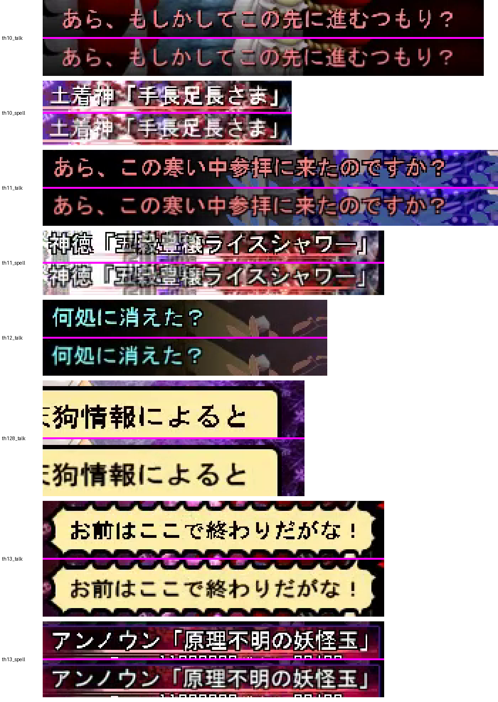

# フェーズ102: 文字の縮小フィルタ(D3DX_AREA_FILTER)の全タイトル確認とAWSでの品質比較

日付: 2026-11-12

## 結論

- **th10・th11・th12・th128・th13 の5タイトルで効く。** どれも会話文・スペルカード名を GDI で2倍の大きさに描き、`D3DXLoadSurfaceFromMemory`(`D3DX_FILTER_TRIANGLE`)で縮小転送している。`D3DX_AREA_FILTER=1` でExtraのリプレイをローカルでフル尺録画した。5本とも試行1回目で完走し、記録スコアと一致した。文字の縁に中間階調が付くだけで、文字以外の描画や位置は変わらなかった(下図)。
- **th15 は今の設定(内部解像度 1280x960)では対象外。** 文字列を 1024x40 のまま等倍で転送しており(`filter=0x1`=NONE)、縮小を伴う転送が1回も無い。フィルタを有効にしても画面は変わらない(文字の範囲の中間階調率がフィルタの有無で同じ 0.082)。th15 の文字は二値のまま表示されるが、これは縮小とは関係なく、ネイティブ d3dx9 でも同じになるはずである。
- **AWS(`c7i.2xlarge` スポット)の品質比較では差が見られなかった。** th11・th12(等倍)・th13(1/2倍速)を、フィルタなし→あり→あり→なしの順に各2回録った。落ち率・FpsMonitor・理論尺・同期マーカーの差は、どれも回ごとのばらつきの範囲だった。th11 はむしろフィルタありの方が落ちが少なかった(フィルタあり0.7・1.1%、フィルタなし1.9・1.4%)。
- 別に見つかったこと:
  1. th12 は `c7i.2xlarge` 等倍では、フィルタなしでも落ち 3.1〜3.3%・理論尺 +1.8〜2.1% で基準外だった(§3.3)。
  2. ローカルで並列2本録ると、th10・th11 が FpsMonitor 20Hz 台まで落ちた(§2.3)。
  3. th15 の1回目でウィンドウ検出がタイムアウトした(MOD 側は正常)。



各組は上がフィルタなし(現行、Wine 内蔵 d3dx9 の最近傍縮小)、下が `D3DX_AREA_FILTER=1`。同じリプレイの同じゲームフレームを、ローカル録画から3倍に最近傍拡大して切り出した。th13 のフィルタなしはフェーズ101の `baseline.mp4`。

## 1. 対象タイトルの確認

フェーズ101で `D3DXLoadSurfaceFromMemory` の import があるタイトル(th10・th11・th12・th128・th13・th15)の MOD には、`InstallD3DXFilterHook()` を組み込み済みだった(既定は無効)。今回は全 MOD を最新の `mods/common/d3dx_filter_hook.cpp`(フェーズ101で高速化した版)で再ビルドした(`mods/common/build_mingw.sh <title>`)。そのうえで `D3DX_LOAD_PROBE=1` で実際の転送を記録した。

| タイトル | 文字の転送(転送元→転送先、フィルタ) | `area-filtered` | 備考 |
|---|---|---|---|
| th10 | 730x36 → 354x17、`0x4`(TRIANGLE) | あり | th11 と同じ形 |
| th11 | 730x36 → 354x17、`0x4` | あり | 会話は4行(y=1・19・37・55) |
| th12 | 730x36 → 354x17、`0x4` | あり | |
| th128 | 1024x44 → 512x20、`0x4` | あり | th13 と同じ形 |
| th13 | 1024x44 → 512x20、`0x4`(フェーズ101) | あり | |
| th15 | 1024x40 → 1024x40、`0x1`(NONE) | **なし** | 内部解像度 1280x960 のため縮小しない |

th06〜th09(D3D8)と th20 は `D3DXLoadSurfaceFromMemory` を使わないため対象外(フェーズ101)。

## 2. ローカル録画(表示の確認)

### 2.1 手順

`scripts/102_run_text_filter_batch.sh` で録った(recorder/ 経由、`--max-attempts 1`)。出力は `/mnt/cache3/sattori-<title>-verify/102/`。

```bash
# 例: th10。<game> <label> <replay> <mode=area|builtin> <hz=60|30|20> <secs=full|秒> の繰り返し
D3DX_LOAD_PROBE=1 scripts/102_run_text_filter_batch.sh /mnt/cache3/sattori-th10-verify/102 \
  th10 area_full th10_03.rpy area 60 full th10 builtin_360 th10_03.rpy builtin 60 360
# 比較(同じゲームフレームを探して並べる。--crop は文字の範囲)
python3 scripts/102_compare_text_frames.py <area_full.mp4> <builtin_360.mp4> <out_dir> \
  --modlog <area_full.modlog.txt> --log <area_full.log> --max-time 360 --crop 60,370,310,26
# 集計と配信版(本番の compute_cut_range・build_convert_cmd、ウォーターマークのみ省略)
python3 scripts/91_summarize_slowmo.py --raw <dir> --delivery <dir>/delivery --sattori ../sattori area_full:th10_03.rpy:60:th10
```

- フィルタありはフル尺、フィルタなしは文字が出る場面まで(360秒。th128 は最初の会話が約387秒なので480秒、th15 は1/2倍速で600秒)。
- `scripts/102_compare_text_frames.py` は、フィルタありの MOD ログにある縮小転送の時刻から場面を選ぶ(`--times` での指定も可)。そのうえで、フィルタなしの動画の ±1.5 秒から、画面全体の平均絶対差が最小のフレーム(60fps 刻み)を探す。リプレイは決定的なので、同じゲームフレームが見つかる(画面全体の MAD 2〜4)。背景のアニメーションには乱数でずれるものがあり、差の外接矩形は画面全体になりやすい。そのため、文字の範囲は全画面の画像を目視して `--crop` で指定した。
- リプレイ: th10_03(Extra クリア、813.8秒)、th11_04(Extra クリア、1018.8秒)、th12_01(Extra クリア、690.9秒)、th128_extra01(Extra、1321.8秒)、th13_06(Extra クリア、765.1秒)、th15_08(Extra 未クリア、764.5秒)。

### 2.2 結果(フィルタあり、フル尺、1本ずつ直列で録画)

落ちは配信版の15秒以降(`scripts/81`)。

| タイトル | 速度 | 終了検知 | FpsMonitor 中央/下位5%/最低 | 理論尺比 | 同期残差 | スコア | 落ち | 文字の範囲の中間階調率(なし→あり) |
|---|---|---|---|---|---|---|---|---|
| th10 | 等倍 | テンプレート照合 | 59.9/59.9/56.8 | +0.48% | -0.0ms | 一致 | 0.7% | 会話 0.312→0.316、スペル 0.550→0.647 |
| th11 | 等倍 | 画面静止 | 60.0/59.9/57.2 | +0.31% | -0.2ms | 一致 | 1.3% | 会話 0.487→0.499、スペル 0.469→0.632 |
| th12 | 等倍 | 画面静止 | 60.0/59.9/57.1 | +0.34% | -0.9ms | 一致 | 0.6% | 会話 0.238→0.295 |
| th128 | 等倍 | 画面静止 | 59.9/59.7/52.2 | +0.03% | -0.5ms | 一致 | 0.9% | 会話 0.107→0.199 |
| th13 | 等倍 | 画面静止 | 59.9/59.9/54.4 | +0.67% | -0.9ms | 一致 | 0.7% | 会話 0.077→0.161、スペル 0.287→0.384 |
| th15 | 1/2倍速 | 画面静止 | 30.0/28.8/20.2 | +1.12% | -0.5ms | 一致 | 1.6% | 会話 0.082→0.082(変化なし) |

- 文字の範囲の中間階調率は、輝度 48〜207 の画素の割合。中間階調率は背景の影響が大きく、数値の上がり方はタイトルごとに違う。白縁の会話文(th10・th11)は上がり方が小さく、黒い縁取りのスペルカード名や、明るい吹き出しの会話文(th128・th13)は大きい。見た目はどれも縁がなめらかになるだけで、字形の崩れ・欠け・位置ずれは無かった。
- th15 の落ち 1.6% はフィルタと無関係で、既知の結果(reports/91: Extra は 1/2倍速でも最低約20Hz、1/3倍速を推奨)と同じ。
- th13 はフェーズ101の 8.4 節のフル尺が初版(重い版)だったため、改良版で取り直した(`/mnt/cache3/sattori-th13-verify/102/area_full.mp4`)。
- 視聴用の配信版は各タイトルの `/mnt/cache3/sattori-<title>-verify/102/delivery/area_full_delivery.mp4`(th12 は `102/seq/delivery/`)。

### 2.3 並列2本の録画で落ちた件

最初は2系統を並列で録っていた(th10→th12→th13 と th11→th128)。その結果、th10・th11 のフィルタありが FpsMonitor 20Hz 台まで落ちた(57Hz 未満の5秒窓が th10 で 179 中 57、th11 で 253 中 59)。llvmpipe は既定で全スレッドを使うので、th10〜th12 クラスを同時に2本動かすと CPU を取り合う。スコアは一致していたが、視聴用には使えないので、1本ずつ直列で取り直した(直列では 57Hz 未満が th10 で 166 中 1、th11 で 210 中 0、th12 で 144 中 0)。並列で録ったものは `102/parallel/` に残した。th12 の並列分は途中から単独になったので `102/area_full.*` に、直列の取り直しは `102/seq/` にある。AGENTS.md の「並列は2インスタンスまで」は th07・th08 程度の軽いタイトルでの実測なので、th10 以降の視聴用・品質用の録画は1本ずつにする方がよい。

### 2.4 th15 のウィンドウ検出のタイムアウト

th15 のフィルタありの1回目は、`ERROR: ゲームウィンドウが検出できませんでした` で失敗した(`102/failed_window/`)。MOD 側では 0.8 秒でウィンドウが出て、メニュー操作からリプレイ再生まで進んでいた。recorder の `wait_for_window()`(40秒、1/2倍速で延長)が X 側でウィンドウを見つけられなかった。直前の th15 のフィルタなしと、取り直しでは約3秒で検出できた。一過性で、フィルタとは関係しない(本番は `--max-attempts` の既定で再試行される)。原因は調べていない。

## 3. AWS での品質比較

### 3.1 手順

- eu-south-2、`c7i.2xlarge` スポット 3台(2b・2c、$0.0519〜0.0568/時)、Ubuntu 24.04(`<AMI_ID>`)、gp3 100GiB。構築は `scripts/91_setup_cpu_instance.sh`、自動終了ガード `shutdown -h +600`。一時キーペア `touhou-recorder-p102-key`(削除済み)。
- 転送: `recorder scripts assets mods/common/build` と、タイトルごとの `games/<t> prefixes/<t>-wined3d-gl mods/<t>_replay_autoplay/build`(zstd で各約 0.6GB)。集計用に sattori の `worker/convert.py`・`worker/recording/`・`worker/pulse.py` と、リプレイ情報の JSON(`--replay-cache`)。
- 1タイトル1台で、フィルタなし→あり→あり→なしの順に各2回録った(録る順番の影響を打ち消すため)。D3DX_LOAD_PROBE は付けていない。

```bash
SETUP_PULSE=1 bash scripts/102_run_text_filter_batch.sh ~/out th11 builtin_1 th11_04.rpy builtin 60 full \
  th11 area_1 th11_04.rpy area 60 full th11 area_2 th11_04.rpy area 60 full th11 builtin_2 th11_04.rpy builtin 60 full
# th13 は hz=30(1/2倍速、本番の推奨)
python3 scripts/91_summarize_slowmo.py --raw ~/out --delivery ~/out/delivery --sattori ~/sattori \
  --replay-cache ~/replays.json builtin_1:th11_04.rpy:60 area_1:th11_04.rpy:60 area_2:th11_04.rpy:60 builtin_2:th11_04.rpy:60
```

### 3.2 結果

全12本が試行1回目で完走し、記録スコアと一致した。終了検知はすべて画面静止検知。

| タイトル(速度) | 録画 | 落ち | FpsMonitor 中央/下位5%/最低 | 理論尺比 | 同期残差 | CPU% |
|---|---|---|---|---|---|---|
| th11(等倍) | なし 1 | 1.9% | 60.0/59.8/57.7 | +0.42% | -0.9ms | 31.8 |
| | あり 1 | 0.7% | 60.0/59.9/59.5 | +0.22% | -0.3ms | 32.0 |
| | あり 2 | 1.1% | 60.0/59.9/59.7 | +0.24% | -0.6ms | 32.0 |
| | なし 2 | 1.4% | 60.0/59.9/59.4 | +0.25% | -0.6ms | 32.1 |
| th12(等倍) | なし 1 | 3.1% | 59.2/57.8/56.9 | +2.10% | -0.4ms | 35.1 |
| | あり 1 | 3.2% | 59.2/58.0/55.7 | +1.73% | -0.3ms | 34.8 |
| | あり 2 | 3.8% | 59.0/57.4/56.2 | +2.20% | -0.9ms | 36.0 |
| | なし 2 | 3.3% | 59.1/58.1/55.6 | +1.83% | -1.0ms | 35.3 |
| th13(1/2倍速) | なし 1 | 0.6% | 30.0/29.9/29.2 | +0.45% | -0.3ms | 25.0 |
| | あり 1 | 0.5% | 30.0/29.9/29.6 | +0.30% | +0.7ms | 25.0 |
| | あり 2 | 0.4% | 30.0/29.9/29.4 | +0.33% | +0.7ms | 25.2 |
| | なし 2 | 0.4% | 30.0/29.9/29.5 | +0.32% | +0.3ms | 25.0 |

- どの指標も、フィルタの有無による差は同じ条件の2回の間の差より小さいか同程度だった。CPU 使用率(mpstat の全体平均)の差も 1 ポイント以下。
- th11 の「判定重複率」は、フィルタあり1回目だけ 2.5% だった(他は 0.0〜0.2%)。原因は調べていないが、落ち率(配信版)は4本で最も低く、FpsMonitor も正常なので、録画品質の問題ではないと判断した。
- フェーズ101 10.2 節で気にしていた「会話の開始時に文字の転送が1フレームへ集中する」件は、案A(フィルタ)では文字の転送1回が0.29ms(現行0.32ms)で集中が起きない。今回も全体の落ち・最低値に差が無かったので、会話開始時の局所的な落ちを窓ごとに数える分析は省いた。

### 3.3 th12 の `c7i.2xlarge` 等倍は基準外

th12 はフィルタの有無にかかわらず、`c7i.2xlarge` 等倍で落ち 3.1〜3.8%、理論尺 +1.7〜2.2%、FpsMonitor 下位5% 57.4〜58.1Hz だった。AGENTS.md の基準(落ち ≤1.5%、下位5% ≥58.2Hz、理論尺 ≤+1.0%)を外れる。docs/titles/th12.md は `c7i.2xlarge` を推奨しているが、フェーズ98の基準ができる前の評価だった。本番で th12 を CPU 等倍で録るなら、`c7i.4xlarge` か 1/2倍速を検討する必要がある(未検証)。th11 は同じ `c7i.2xlarge` 等倍で 0.7〜1.9% と、境界付近だった。

### 3.4 ダウンロードした動画

転送料金を抑えるため、配信版(本番の変換、ウォーターマークなし)のフィルタなし1回目・あり1回目と、ログ・集計だけを持ち帰った。生録画と2回目の配信版はインスタンスと一緒に破棄した。

| タイトル | 場所 | ファイル |
|---|---|---|
| th11 | `/mnt/cache3/sattori-th11-verify/102/aws_c7i2x/` | `builtin_1_delivery.mp4`・`area_1_delivery.mp4`(各約1.06GB) |
| th12 | `/mnt/cache3/sattori-th12-verify/102/aws_c7i2x/` | `builtin_1_delivery.mp4`・`area_1_delivery.mp4`(各約0.66GB) |
| th13 | `/mnt/cache3/sattori-th13-verify/102/aws_c7i2x_half/` | `builtin_1_delivery.mp4`・`area_1_delivery.mp4`(各約0.73GB) |

視聴確認はまだ(ユーザーが後で行う)。

### 3.5 費用と後始末

`c7i.2xlarge` スポット3台を各約1.5〜2.2時間(計約5.5時間 × 約$0.053 ≒ $0.3)。ダウンロードは約5GB。3台とも終了し、一時キーペアは削除した。残存リソースの増加は無い(`docs/aws-resources.md` は変更なし)。

## 4. 今後

- **既定での有効化**: 表示の崩れは無く、録画品質への影響も見られなかった。視聴で問題が無ければ、th10・th11・th12・th128・th13 で `D3DX_AREA_FILTER=1` を既定にする(MOD 側で未設定なら有効にするか、recorder・本番のワーカーから環境変数を渡す)。th15 は今の解像度では効かないので、有効にしても無効にしても同じ。
- th15 を 640x480(`th15.cfg` 0x1F=3)で動かす場合は縮小転送が起きる可能性がある。その場合は効くはず(未確認)。
- th12 の CPU 等倍のインスタンス選定の見直し(§3.3)。
- 並列録画の上限の見直し(§2.3)。

## 5. 変更ファイル

- `scripts/102_run_text_filter_batch.sh`(新規): フィルタの有無・速度・尺を指定して recorder で順に録画する(ローカル・AWS 共通、`SETUP_PULSE=1` で AWS の pulseaudio を準備)
- `scripts/102_compare_text_frames.py`(新規): フィルタの有無で録った2本の動画から同じゲームフレームを探し、文字の範囲を並べる
- `reports/assets/102_text_filter_titles.png`(新規)
- `docs/known-limitations.md`・`docs/titles/{th10,th11,th12,th128,th13,th15}.md`・`AGENTS.md`・`reports/README.md`: 本フェーズの結果を反映
