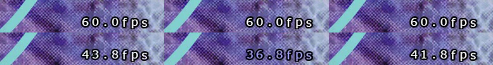

# フェーズ103: th14(東方輝針城 ver1.00b)の導入とクラウド検証

日付: 2026-11-15〜16

## 0. 結論

- th14(ver1.00b、CDリッピング+公式アップデータ、`games/th14`)をパイプラインへ追加した。ローカル・AWSのフル尺録画18本が全て試行1回目で最後まで再生され、**スコアは全てリプレイ記録値と一致**した(内部値×10)。
- **推奨は`g6f.2xlarge`(GPU描画)の2倍速**。Extra・Lunatic全クリア(霊夢A・魔理沙B)の計4本が基準①〜④を全て満たした(落ち0.1〜0.2%)。等倍も合格、3倍速はキャプチャが追いつかず落ち5.8%で基準外。
- **CPU描画の等倍は不可**(ローカル・`c7i.4xlarge`とも落ち4.2〜5.8%)。th15と同じく1280x960の塗りつぶしが律速。
- CPUのフォールバックは**`c7i.4xlarge`の1/2倍速**(全体では落ち0.7〜0.8%で基準内だが、弾消しエフェクトなどの数秒間は22Hz・14.6Hzまで落ちる。30秒窓の最悪は4.4%・8.6%)。Extraは1/3倍速なら`c7i.2xlarge`でも基準内。`c7i.2xlarge`の1/2倍速は基準外。
- 低速録画の**処理落ち早期検知の誤検知**を修正した(`recorder/stutter.py`、§4)。画面上fps表示の補正も実装した(§5)。
- **視聴確認は未実施**(判定は全て数値)。動画は`/mnt/cache3/sattori-th14-verify/`にある(§7)。

## 1. 準備

作業前に`sattori-home-worker`が停止(inactive・disabled)で、wine・ffmpegのプロセスが無いこと、`auto_null`シンクがあることを確認した(作業後も停止のまま)。

| 項目 | 内容 |
|---|---|
| ゲーム | `games/th14`(`th14.exe` 897536バイト、sha256 `f08e885e…`)。Steam版は`games/th14_steam`(reports/04) |
| prefix | `Xvfb :199 & DISPLAY=:199 bash ../sattori/worker/setup_wineprefix.sh $PWD/prefixes/th14-wined3d-gl $PWD/games/assets/msgothic.ttc $PWD/games/assets/msmincho.ttc` |
| MOD | `mods/th14_replay_autoplay/dllmain.cpp`(th13のMODを基に作成)。ビルドは`mods/common/build_mingw.sh th14` |
| 設定 | `recorder/games.py`の`GameConfig(game_id="th14")`: `display=":85"`、`xvfb_screen="1400x1100x24"`、`replay_dest_filename="th14_ud0000.rpy"`、`appdata_dir=…/ShanghaiAlice/th14`、`cfg_filename="th14.cfg"`、`poll_side_stream=True`、`still_detect_exclude_rect=[(85,426,380,855)]`、`crtc_mode="1400x1050"` |

- `th14.exe`のインポートはDINPUT8・DSOUND・d3d9・d3dx9_43。入力は`GetDeviceState`(60Hz)で、`PressKey`(DIKコード)が通る。メニュー操作は 10秒待ち → Down×3 → Enter → Right → Enter → Enter(ユーザー指定どおりで初回から成功)。
- スコア監視(`thprac_th14.cpp`): score=`0x4f5830`(base RVA `0xf5830`)、graze=+0x10、lives=+0x34、stage=+0x74(`0x4f58a4`)。ステージ番号は1始まりでExtraは7。
- **`th14.cfg`のオフセット0x39が「起動時に毎回訊ねる」**。配置されていたcfgは1で、起動時に解像度選択ダイアログ(179x140)が出て止まった。0にするとダイアログ無しで1280x960のウィンドウが開く。`games/th14/th14.cfg`を0へ書き換え、元のファイルは`games/th14/th14.cfg.orig`に残した。画面サイズはth15と同じ0x1F(5=1280x960)。

リプレイ(`node ../sattori/packages/replay-parser/dist/cli/index.js games/th14/replay/*.rpy -j`)。Silent Seleneからの追加取得は不要だった。

| 用途 | ファイル | 内容 | frameCount(理論尺) | 記録スコア |
|---|---|---|---|---|
| Extra | `th14_08.rpy` | 霊夢A Extra クリア | 46042(767.4秒) | 160711180 |
| 通常 | `th14_22.rpy` | 霊夢A Lunatic 全クリア | 90336(1505.6秒) | 409380990 |
| 通常(2本目) | `th14_24.rpy` | 魔理沙B Lunatic 全クリア | 97138(1619.0秒) | 595370420 |

## 2. 録画コマンド

```bash
# ローカル(Xvfb)
python3 scripts/25_record_replay_e2e_multigame.py --game th14 --replay th14_08.rpy --max-attempts 1 \
  --output /mnt/cache3/sattori-th14-verify/full_extra_th14_08.mp4

# AWS CPU(eu-south-2、Ubuntu 24.04 <AMI_ID>、gp3 100GiB、Spot)。起動→構築→録画→回収→終了を1台ぶん通しで行う
scripts/103_run_cloud_cell.sh c7i.4xlarge <subnet> p103-4xl <秘密鍵> /mnt/cache3/sattori-th14-verify/aws2 \
  th14 4xl_half_extra th14_08.rpy builtin 30 full  th14 4xl_half_lunatic th14_22.rpy builtin 30 full \
  th14 4xl_third_extra th14_08.rpy builtin 20 full th14 4xl_x1_extra th14_08.rpy builtin 60 full \
  th14 4xl_x1_lunatic th14_22.rpy builtin 60 full
# (c7i.2xlargeは REMOTE_EXTRA_ARGS="--max-duplicate-rate 95" を付けた)

# AWS GPU(us-west-2c、g6f.2xlarge Spot、<AMI_ID>、gp3 150GiB、NVIDIA L4-6Q・GRID 595.91.07)
REGION=us-west-2 AMI=<AMI_ID> SG=<SECURITY_GROUP_ID> VOL=150 scripts/103_launch_spot.sh g6f.2xlarge <SUBNET_ID> p103-g6f
SETUP_SCRIPT=scripts/89_setup_gpu_instance.sh scripts/103_provision_instance.sh <ip> <秘密鍵>
# インスタンス上(PulseAudioは systemctl --user mask → 手動起動、reports/91)
EXTRA_ARGS='--gpu-display --gpu-encode --crtc-mode 1400x1050 --max-attempts 1' bash scripts/89_run_speedup_batch.sh \
  th14 g6f_x1_extra th14_08.rpy 1 th14 g6f_2x_extra th14_08.rpy 2 th14 g6f_2x_lunatic th14_22.rpy 2 \
  th14 g6f_x1_lunatic th14_22.rpy 1 th14 g6f_3x_extra th14_08.rpy 3

# 集計(等倍以外は scripts/47 で等倍へ戻してから数える)
python3 scripts/103_summarize.py --restored /mnt/cache3/sattori-th14-verify/restored --frames 46042 --score 160711180 \
  /mnt/cache3/sattori-th14-verify/aws2/4xl_half_extra:30 ...
```

CPUインスタンスの構築は`scripts/91_setup_cpu_instance.sh`、録画バッチは`scripts/102_run_text_filter_batch.sh`(`mode=builtin`)を使った。転送は`recorder scripts assets games/th14 prefixes/th14-wined3d-gl mods/common/build mods/th14_replay_autoplay/build`。

## 3. 結果

`scripts/103_summarize.py`の出力。①は等倍へ戻した60fps動画のプレイ区間(先頭45秒を除く)のユニークフレームで数えた落ち率、②はリプレイ再生中のFpsMonitor(5秒窓)、③は「stage≥1を初めて見た時刻〜最後にスコアが変わった時刻」をゲーム内時間に直して`frameCount/60`と比べた値(ScoreMonitorが1秒間隔なので±0.2%程度の粗さ)、④は同期マーカーのmux後残差。

### Extra(`th14_08.rpy`)

| 環境 | 速度 | ①落ち率(実効fps) | 30秒窓の最悪 | ②平均/下位5%/最小(Hz) | ③理論尺比 | ④同期 | 総録画時間 | 判定 |
|---|---|---|---|---|---|---|---|---|
| ローカル(Ryzen 7 5700X) | 等倍 | 5.7%(56.58) | 22.2% | 57.5/49.7/22.6 | +4.51% | -1.0ms | 837.1秒 | 不合格 |
| c7i.2xlarge | 等倍 | 17.0%(49.82) | 39.6% | 50.6/34.4/18.0 | +19.05% | -0.8ms | 950.3秒 | 不合格 |
| c7i.4xlarge | 等倍 | 5.8%(56.53) | 21.3% | 57.7/49.0/21.8 | +4.25% | -0.9ms | 833.5秒 | 不合格 |
| c7i.2xlarge | 1/2 | 2.9%(58.27) | 12.4% | 29.6/27.6/17.2 | +1.45% | -0.0ms | 1606.7秒 | 不合格 |
| c7i.4xlarge | 1/2 | 0.8%(59.54) | 4.4% | 29.9/29.9/22.2 | +0.40% | -0.3ms | 1590.4秒 | 合格(局所的な落ちあり) |
| c7i.2xlarge | 1/3 | 0.9%(59.48) | 3.3% | 20.0/20.0/16.6 | +0.34% | -0.6ms | 2375.5秒 | 合格(局所的な落ちあり) |
| c7i.4xlarge | 1/3 | 0.3%(59.82) | 1.2% | 20.0/20.0/19.4 | +0.16% | -0.8ms | 2369.9秒 | 合格※ |
| g6f.2xlarge | 等倍 | 0.0%(60.00) | 0.1% | 59.9/59.7/59.6 | +0.33% | -0.6ms | 802.6秒 | 合格 |
| g6f.2xlarge | 2倍 | 0.2%(59.90) | 1.2% | 119.7/119.5/118.9 | +0.45% | +0.5ms | 427.7秒 | 合格 |
| g6f.2xlarge | 2倍(2回目) | 0.1%(59.94) | 1.3% | 119.8/119.5/119.4 | +0.46% | +0.0ms | 427.9秒 | 合格 |
| g6f.2xlarge | 3倍 | 5.8%(56.52) | 11.4% | 178.5/177.6/172.8 | +0.98% | +0.8ms | 287.4秒 | 不合格(①) |

※ `c7i.4xlarge`の1/3倍速は`--max-duplicate-rate`を既定のままにしたため、録画は完走したのにパイプラインが破棄扱い(rc=1)にした。20Hzの既定閾値76.67%を実測81.9%が超える既知の誤判定(`docs/known-limitations.md`)。動画は残っており表はその値。

### Lunatic全クリア(`th14_22.rpy`、魔理沙Bは`th14_24.rpy`)

| 環境 | 速度 | ①落ち率(実効fps) | 30秒窓の最悪 | ②平均/下位5%/最小(Hz) | ③理論尺比 | ④同期 | 総録画時間 | 判定 |
|---|---|---|---|---|---|---|---|---|
| ローカル | 等倍 | 4.2%(57.51) | 27.2% | 58.3/49.9/17.8 | +2.53% | -0.8ms | 1579.2秒 | 不合格 |
| c7i.4xlarge | 等倍 | 4.9%(57.08) | 27.6% | 58.4/51.4/19.2 | +2.27% | -0.0ms | 1575.1秒 | 不合格 |
| c7i.2xlarge | 1/2 | 2.0%(58.78) | 16.9% | 29.7/28.0/9.0 | +0.75% | -1.0ms | 3093.4秒 | 不合格 |
| c7i.4xlarge | 1/2 | 0.7%(59.56) | 8.6% | 29.9/29.9/14.6 | -0.05% | -0.4ms | 3059.2秒 | 合格(局所的な落ちあり) |
| g6f.2xlarge | 等倍 | 0.0%(59.98) | 0.2% | 59.9/59.7/59.1 | -0.18% | -0.3ms | 1535.8秒 | 合格 |
| g6f.2xlarge | 2倍 | 0.2%(59.88) | 1.8% | 119.7/119.4/117.2 | -0.13% | +0.2ms | 810.1秒 | 合格 |
| g6f.2xlarge | 2倍(魔理沙B) | 0.2%(59.89) | 2.2% | 119.7/119.4/118.9 | -0.07% | +0.7ms | 871.0秒 | 合格 |

### 読み取り

- **CPU描画の落ちは特定の場面に集中する。** Extraは再生開始から約510秒(ボスのスペル終了時、画面全体の弾がアイテムに変わる弾消しエフェクトと大きな円形エフェクトが重なる場面)、Lunaticは4面(約700〜820秒)。ローカル(8コア16スレッド)と`c7i.4xlarge`で深さがほぼ同じ(Extra 22.6Hzと21.8Hz)で、読み込み待ちではなく描画負荷そのもの。th15・th20と同じllvmpipeの塗りつぶし律速(reports/99)と見られる。
- このため1/2倍速(目標30Hz)でも、等倍で30Hzを割る場面は目標に届かない。`c7i.4xlarge`の1/2倍速は全体の落ちが0.7〜0.8%で基準①②を満たすが、Lunatic 4面の最小は14.6Hzで、30秒窓では8.6%落ちている。低速録画は処理落ち後にBGMが映像より先行する既知の制約がある(reports/91)ので、採否は視聴で決める必要がある。
- GPU描画は等倍・2倍速とも最小が目標の97.7%以上で、局所的な落ちも無い。3倍速はゲームは178Hzで進むがキャプチャ側が追いつかない(th15の3倍速と同じ傾向、reports/87)。
- 終了検知は全録画で画面静止検知が正しく働いた(ユーザー指定の除外矩形)。同期残差は全て±1.0ms以内。

### 費用の目安(尺1時間あたり、Spot単価は検証時の実測)

| 構成 | 実時間/尺 | 単価 | 尺1時間あたり |
|---|---|---|---|
| g6f.2xlarge 2倍速 | 0.56 | $0.181/時(us-west-2c)。eu-south-2aは$0.089/時だった | 約$0.10(eu-south-2aなら約$0.05) |
| g6f.2xlarge 等倍 | 1.05 | 同上 | 約$0.19 |
| c7i.4xlarge 1/2倍速 | 2.07 | $0.106/時(eu-south-2b/c) | 約$0.22 |
| c7i.2xlarge 1/3倍速 | 3.10 | $0.056〜0.061/時 | 約$0.18 |

起動・構築・配信版変換の時間は含まない。

## 4. 低速録画の処理落ち早期検知の誤検知(修正)

最初のAWSバッチで、1/2倍速のExtraが2台とも開始66秒で破棄された(`stutter probe: elapsed=31.3s dup_fraction=0.89`、閾値0.85)。FpsMonitorは30.0Hzで正常だった。

- 原因: サブストリーム方式(`poll_side_stream=True`)のprobeは、8fpsのサブ出力の隣接フレームを比べる。実時間の間隔が固定なので、1/2倍速ではその間にゲームが進む量が半分になり、動きの少ないステージ冒頭で「静止」と数えられた。個別キャプチャ方式は間隔を`scale_seconds()`で伸ばしているが、サブストリーム方式は伸ばしていなかった。
- 修正: `recorder/stutter.py`の`probe_stutter()`で、`MENU_TIME_SCALE`(1/2倍速なら2)枚おきに間引いて比べる。等倍・倍速は従来どおり。
- 修正後は1/2倍速・1/3倍速の計6本が誤検知なしで完走した。th15・th06ncなどサブストリーム方式の他タイトルの低速録画にも同じ修正が効く(それらでの再確認はしていない)。

## 5. 画面上fps表示の補正

`python3 scripts/90_find_fps_timer_callsites.py games/th14/th14.exe`と`--disasm`で確認した。構造はth15と同じ(reports/93)。

| RVA | 内容 |
|---|---|
| `0x2e640` | fps書式文字列(`0x4bdf00`)の`push` |
| `0x2e4d0` | fpsの更新。`call 0x46ac20`(戻り先`0x2e4e0`)の時刻差でフレーム数を割り`[esi+0x34]`へ入れる |
| `0x6ac20` | 時刻取得関数(EBPフレームあり)。QueryPerformanceCounterの戻り先は`0x6ac5e` |

実装: `InstallFpsDisplayCorrectionHookViaCaller(0x0006ac5e, 0x0002e4e0)`(`InstallSpeedHackHook()`の後)。`TIMER_PROBE=1`のときは二重フックを避けるため入れない。

ローカルの60秒録画(Extra)で右下の表示を確認した(録画の60%・75%・90%地点)。

| 条件 | 補正倍率 | FpsMonitor | 表示 |
|---|---|---|---|
| `FPS_LIMIT_TARGET_HZ=30 SPEED_HACK_MULTIPLIER=0.5` | 1.0(QPC偽装だけで等倍換算になる) | 30.0Hz | 60.0 / 60.0 / 60.0 |
| `FPS_LIMIT_TARGET_HZ=30`のみ | 0.5 | 29.9Hz | 60.0 / 60.0 |
| `FPS_LIMIT_TARGET_HZ=120 SPEED_HACK_MULTIPLIER=2`(CPU描画) | 1.0 | 82〜90Hz | 43.8 / 36.8 / 41.8(実測の等倍換算で正しい) |



上段が1/2倍速(`SPEED_HACK_MULTIPLIER`併用)、下段がCPU描画の2倍速。AWSの録画での表示の目視はしていない。

## 6. つまずいた点

- **GPU描画面のCRTCモード**: `--crtc-mode 1280x960`ではウィンドウが1280x940に縮んだ(装飾込みで画面に収まらない)。`1400x1050`で1280x960になる。`GameConfig.crtc_mode`に設定済み。
- **GPUインスタンスのPulseAudio**: `scripts/89_run_speedup_batch.sh`の起動だけでは`Connection refused`になった。`systemctl --user mask --now pulseaudio.socket pulseaudio.service`の後に手動起動して解消(`scripts/102`の`SETUP_PULSE=1`と同じ手順)。
- **Spot中断**: `c7i.2xlarge`(eu-south-2c)が起動約30分で1回中断された(`Server.SpotInstanceTermination`)。2bで作り直した。
- **自分のスクリプトの不具合で2回やり直した**: (1) 回収スクリプトのリモートコマンドが未完了のあいだ終了コード1を返し、20分後に「到達不能」と誤判定してインスタンスを終了させた(修正済み)。(2) 同じバッチを二重に起動した。いずれも録画のやり直しで済み、結果には影響しない。
- 途中でEC2がユーザーにより停止され、インスタンスの作成からやり直した(`/mnt/cache3/sattori-th14-verify/aws/`は最初の回の不完全な成果物。`2xl_x1_extra`だけ完全)。

## 7. 成果物と後始末

`/mnt/cache3/sattori-th14-verify/`:

- ローカル: `full_extra_th14_08.mp4`、`full_lunatic_th14_22.mp4`、`fpsdisp/`(fps表示の確認)
- AWS: `aws2/<label>.mp4`(`4xl_*`・`2xl_*`・`g6f_*`、各`.log`・`.modlog.txt`・`.mpstat.txt`)。低速・倍速は生の録画(1/2倍速は尺が2倍)
- 等倍へ戻した動画: `restored/<label>_restored.mp4`(`scripts/47_descale_th20_slowmo.py`)。**視聴にはこちらが向く**

インスタンスは計8台起動した(c7i.4xlarge×3、c7i.2xlarge×4、g6f.2xlarge×1)。全て終了済み。一時キーペア`touhou-recorder-p103-key`(eu-south-2・us-west-2)は削除、us-west-2のセキュリティグループへ足した作業元IPのSSH許可も取り消した。残存リソースの増加なし(`docs/aws-resources.md`変更なし)。Spot単価は全て$0.2/時以下。

## 8. 未了

- 視聴確認(特に`c7i.4xlarge` 1/2倍速の局所的な落ちとBGMの先行、GPU 2倍速の音質)
- `c7i.4xlarge`の1/3倍速のLunatic、`c7i.8xlarge`(Spot $0.23/時で許可上限を超えるため未実施)
- eu-south-2での`g6f.2xlarge`(本番とG系クォータを共有するため、今回は別枠のus-west-2で検証した)
- 文字の縮小フィルタ(`D3DX_AREA_FILTER=1`)がth14に効くか(MODには組み込み済み・既定は無効。th15と同じ1280x960なので対象外の可能性が高い)
- 内部解像度を960x720に下げたCPU録画(th15ではreports/99で検討、画質が下がる)
- sattori本番への移植

## 変更ファイル

`mods/th14_replay_autoplay/dllmain.cpp`(新規)、`recorder/games.py`、`recorder/stutter.py`、`scripts/103_*.sh`・`scripts/103_*.py`(新規)、`scripts/89_run_speedup_batch.sh`(完了マーカー)、`docs/titles/th14.md`(新規)、`docs/titles/README.md`、`docs/known-limitations.md`、`docs/new-title-checklist.md`、`docs/recording-results-matrix.md`、`reports/README.md`、`AGENTS.md`
