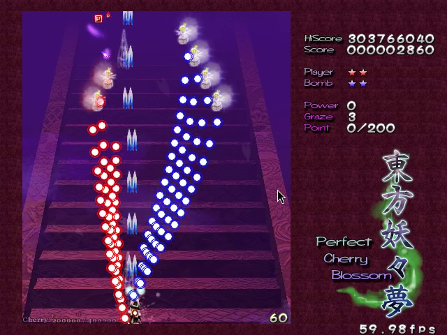
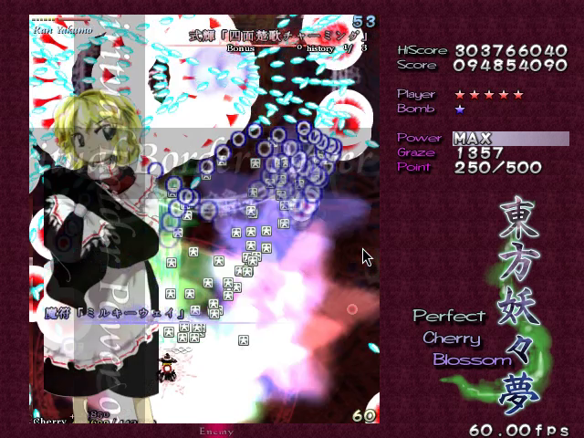
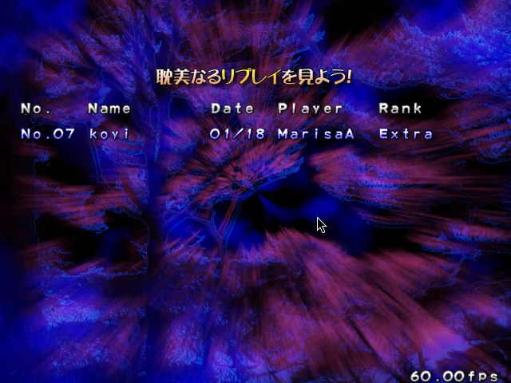

# フェーズ11: リプレイ全編録画とリプレイ終了自動検知の検証

日付: 2026-07-15

## 背景

前フェーズまでで、MODによるメニュー自動操作(th07/th08)と音声キャプチャの実現可能性がそれぞれ個別に確認できていた。次のステップとして、実際の`.rpy`リプレイファイルを最初から最後まで自動で録画し、リプレイ終了を検知して録画を停止できるかを検証した(フェーズ3で積み残していた「デシンクの有無判定」に先立つ、実運用上の核心的な検証項目)。

あわせて、前回の手動録画(`runs/manual_th07_audio_test/video.mp4`)で発覚していた「ウィンドウのタイトルバーが映り込み、ゲーム画面が右に1px・下に29pxズレる」問題の原因究明・解消も行った。

## ウィンドウオフセット問題の原因と解決

原因を切り分けたところ、`xdotool getwindowgeometry`が返す座標と、`xwininfo`が返す実際のクライアント領域の絶対座標が一致しないことが分かった。同一ウィンドウに対して:

- `xdotool getwindowgeometry --shell`: `X=4 Y=49`
- `xwininfo -id`の`Absolute upper-left X/Y`: `X=3 Y=29`

の2通りの値が得られ、実際に両座標でx11grabしたスクリーンショットを比較したところ、**`xwininfo`側の座標のみがタイトルバー等の装飾を含まない正確なクライアント領域を指していた**(`xdotool getwindowgeometry`側は上端が20pxほど余分にずれ、ゲーム画面の上部が欠けていた)。前回の録画はおそらくウィンドウ位置を全く考慮せず画面原点(0,0)からクロップしていたため、この装飾ぶんのズレがそのまま映り込んでいたと考えられる。

対策として、`scripts/11_record_th07_replay_e2e.py`では以下の手順で毎回動的にクロップ座標を取得するようにした:

1. `xdotool search --pid <ゲームプロセスのPID>`で対象プロセスが所有する全ウィンドウを列挙
2. 各ウィンドウを`xwininfo -id`で調べ、`IsViewable`かつ十分なWidth/Heightを持つものを実ウィンドウと判定(MODの`window_wait.cpp`と同種のフィルタ条件)
3. その`Absolute upper-left X/Y`と`Width/Height`をそのままffmpegの`-video_size`・`-i :DISPLAY+X,Y`に使用

この方式で、タイトルバー混入・座標ズレのない録画ができることを確認した(`reports/assets/th07_e2e_replay_start.png`)。

## リプレイ終了自動検知の実装

MOD(`mods/th07_replay_autoplay/`)はゲーム内部状態を外部に通知する仕組みを持たないため、画面のスクリーンショット比較による検知方式を採用した。

- **基準フレームの撮影**: MODのキー操作シーケンスのうち、Step2(「Replay」確定)からStep3(1件目のリプレイファイル選択)までの間、リプレイファイル一覧画面がおよそ700〜800msほぼ静止して表示される。MODのログファイル(`th07_autoplay.log`)をリアルタイムでtailし、「Step 2」のログ行を検出してから550ms後にこの画面を1枚撮影し、基準フレームとする
- **比較方法**: 基準フレームをグレースケール化・160x120にダウンサンプルしたものを保持し、リプレイ再生開始後は2秒間隔で同様に撮影・ダウンサンプルした画像との平均絶対誤差(MAD)を計算する
- **判定**: MAD < 8.0 が3回連続(約4〜6秒間の安定)したら「一覧画面に復帰=リプレイ終了」と判定し、録画(ffmpeg)にSIGINTを送って停止する
- **事前キャリブレーション**: 本番実行前に、同一の一覧画面を約150ms間隔で2回撮影した場合のMADは2.3、一覧画面とゲームプレイ中の画面のMADは25.4という結果を得ており、閾値8.0には十分なマージンがあることを確認してから本番投入した
- **フェイルセーフ**: 22分のタイムアウトを設定した(クリア時のエンディング演出などで一覧画面に戻らないケースに備える保険。今回は未使用)

実装は`scripts/11_record_th07_replay_e2e.py`。

## 検証結果: th7_07.rpy(Extraステージ)の全編録画に成功

`th7_07.rpy`(Extraステージのリプレイ、20分以内に終わる想定)を対象に、MODインジェクション→メニュー自動操作→リプレイ再生→終了検知→録画停止までの一連の流れを人手を介さず自動実行した。

- **総録画時間: 839.7秒(約14分)**。事前の想定通り20分以内に収まった
- **終了検知は非常に明瞭に機能した**。一覧画面に復帰した直後の3回のポーリングでMADはいずれも**0.00(完全一致)**となり、監視期間(約827秒)を通じて誤検知は一度も発生しなかった(ゲームプレイ中のMAD最小値は26.77で、閾値8.0を大きく上回っている。ダイアログの静止画面やボム発動時の白フラッシュなどでも閾値を割り込むことはなかった)
- **出力ファイル**: `runs/th07_full_replay_audio/video.mp4`。映像 640x480 / h264 / 60fps、音声 aac / 48000Hz / stereo。`ffmpeg -af volumedetect`で`mean_volume: -9.2dB`を確認し、無音でないことを確認した
- **画面のズレ・タイトルバー混入は解消**したことを目視確認した

3枚目の画像は録画終了直前のフレームで、リプレイ一覧画面に「No.07」(=`th7_07.rpy`)が選択された状態で表示されており、終了検知がまさに意図通りのタイミングで発火したことが視覚的に確認できる。

## リプレイファイルの絞り込みについて

MODの実装は常に「1件目のリプレイファイル」を選択する固定シーケンスであるため、意図しないファイルが再生されないよう、検証用instanceディレクトリ(`instances/th07-recording-test/replay/`)には`th7_07.rpy`のみを配置して実行した(`games/th07/replay/`には他に`th7_08.rpy`・`th7_09.rpy`も存在するため)。

## 既知の限界・今後の課題

1. 終了検知は「リプレイファイル一覧画面への復帰」を前提にしている。クリア済みリプレイでエンディング演出が入り主メニューに戻るようなケースでは基準フレームと一致せず、22分のタイムアウトに頼ることになる(今回は未検証)。主メニュー画面も第二の基準フレームとして追加すれば対応できると考えられる
2. 検知はスクリーンショットのポーリング(2秒間隔)によるものであり、検知から停止までに数秒(今回は4〜6秒)のタイムラグがある。録画データ自体は正確な終了時点を含むので実用上の問題は小さいが、より精密な終了点を求める場合はMOD側にゲーム内部状態を通知するフックを追加する方式も検討できる
3. th08や他タイトルでも同じ手法(xwininfoベースの座標取得、一覧画面とのMAD比較)が使えるかは未検証。UIレイアウトやアニメーションの有無によって閾値調整が必要になる可能性がある

## 成果物

- スクリプト: `scripts/11_record_th07_replay_e2e.py`
- 録画動画: `runs/th07_full_replay_audio/video.mp4`(839.7秒、640x480/60fps、音声付き。`.gitignore`対象のためリポジトリには含まれない)
- 検証用instance: `instances/th07-recording-test/`(`.gitignore`対象)
