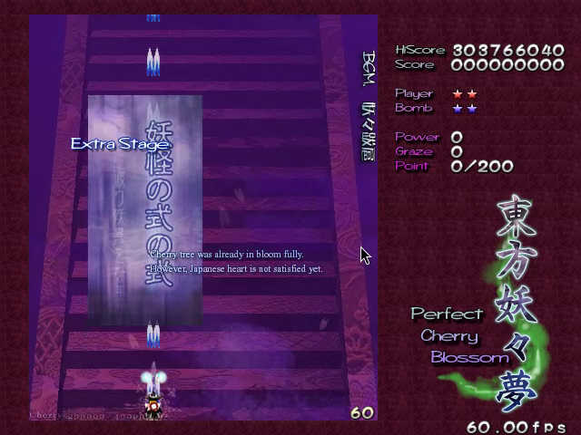
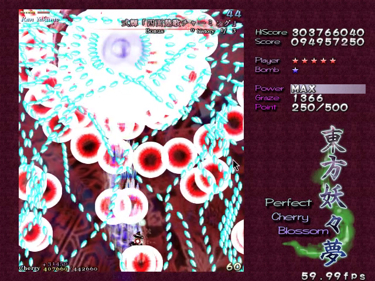
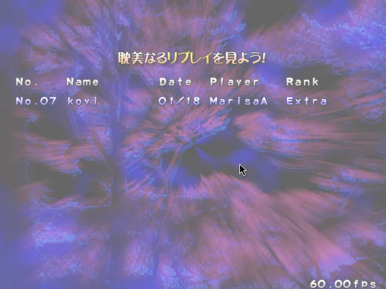

# フェーズ12: 録画の処理落ち原因調査と修正

日付: 2026-07-15

## 背景

フェーズ11で作成した全編録画(`runs/th07_full_replay_audio/video.mp4`)について、ユーザーから「最初から最後まで処理落ち(カクカク)している」との指摘を受けた。原因を調査し、修正を行った。

## 症状の定量化

`mpdecimate`フィルタで、直前フレームとほぼ同一の重複フレームの割合を計測したところ、全50301フレーム中ユニークなのはわずか3479枚(**6.9%**、残り93.1%が重複)だった。0-60秒目から780-838秒目まで区間別に見ても一様に3〜10%程度しかユニークフレームがなく、特定の重い場面に偏った現象ではないことを確認した。

## 調査の過程(検証して棄却した仮説)

1. **外部プロセスの偶然のCPU負荷スパイク説**: `sar`の履歴データで、録画時間帯はシステム全体のidle率が74〜78%(平常時は約89%)と高めだったが、その後何度再現しても25秒の短時間テストはクリーンな結果になり、しかもそのうち1回はシステムidle率が本番と同水準(75.2%)であってもクリーンだった。→**否定**
2. **th07.exe自体が重い場面(ボス戦等)でCPUを食いすぎる説**: ボス戦(八雲藍、「MilkyWay」スペルカード)を含む全編でpidstatを1秒間隔で記録したところ、th07.exeのCPU使用率は序盤(153.7%)〜ボス戦(198.9%)でほぼ一定で、重複フレーム率との相関もほぼゼロ(r=0.17)だった。→**否定**
3. **終了検知用の2秒おきポーリング(スクリーンショット撮影)説**: ポーリングを3分間(81回)持続させた連続録画でも重複率は悪化せず、99%以上ユニークのままだった。→**否定**
4. **録画時間の長さ自体(サーマルスロットリング等)説**: ポーリングなしで5分間連続録画したが、全区間で悪化は見られなかった(83〜99%ユニーク)。→**否定**

## 真因: 録画開始と同時に走る50ms間隔のログ監視タイトループ

本番スクリプト(`scripts/11_record_th07_replay_e2e.py`)は、ウィンドウ検出直後(MODによるメニュー自動操作が始まる前)にffmpeg録画を開始し、それと並行して、メニュー操作完了(`sequence complete`ログ)を検出するために**ログファイルを50ms間隔でポーリングするタイトループ**を実行していた。これがffmpegの`x11grab`+`libx264`+`pulse`が初期同期を取る非常にデリケートな起動直後の期間と重なり、CPU/スケジューリングを奪うことで、**録画全体のフレームタイミングの基準がずれ、以降ずっと(録画時間の長さによらず)重複フレームで埋め続ける状態に入る**ことが判明した。

この仮説を検証するため、「録画開始と同時に50ms間隔のログ監視ループを走らせる」構造だけを再現した最小テスト(2.5分)を行ったところ、たった2.5分のテストで**本番と同水準の重複率(2〜5%ユニーク)が再現した**。これで、それまでの短時間テストが軒並みクリーンだった理由(いずれも「メニュー自動操作完了後」に録画を開始する構造で行っており、この並行処理自体が発生していなかった)も説明がついた。

## 修正内容

`scripts/11_record_th07_replay_e2e.py`の処理順序を変更し、**メニュー自動操作の完了(sequence complete)を待ちきってから録画(ffmpeg)を開始する**2段階構成にした。基準フレーム(リプレイ一覧画面)の撮影は録画開始前に完了させる。この結果、録画範囲は「ウィンドウ検出時点から」ではなく「リプレイ本編開始時点から」に変わる(メニュー自動操作の様子は録画に含まれなくなる)。

## 修正後の検証結果

同じ`th7_07.rpy`を修正後のスクリプトで再度全編録画したところ:

- 総録画時間: 830.3秒(約13.8分)
- **全49800フレーム中47043枚がユニーク(94.5%)、重複はわずか5.5%**(修正前は93.1%が重複)
- 区間別でも86〜99%程度がユニークで、以前のような一様な劣化は解消された
- 出力: 640x480/h264/60fps、aac/48000Hz/stereo、`mean_volume: -9.2dB`(無音でないことを確認)
- 目視でもボス戦(八雲藍、「MilkyWay」スペルカード)を含め、滑らかな描画を確認した

| 区間 | 修正前ユニーク率 | 修正後ユニーク率 |
|---|---|---|
| 0-60s | 3.4% | 91.4% |
| 400-460s(ボス戦) | 7.3% | 96.9%(400-460s相当) |
| 全体 | 6.9% | 94.5% |

## 教訓

ffmpegの`x11grab`によるリアルタイム録画は、起動直後の初期同期期間が外乱に非常に弱い。**録画(ffmpeg)開始とほぼ同時に、短間隔のポーリング処理(タイトループ)を同一の親プロセス内で並行実行してはいけない**。一度フレームタイミングの基準がずれると、その後CPUに余裕があっても回復せず、録画全体が重複フレームだらけになる。録画対象の準備(メニュー自動操作の完了待ち等、頻繁なポーリングを伴う処理)は録画開始前に完了させ、録画開始後は極力ffmpegプロセスの起動・初期同期を妨げないようにする必要がある。この教訓は`AGENTS.md`にも追記した。

## 成果物

- 修正版スクリプト: `scripts/11_record_th07_replay_e2e.py`
- 検証用録画: `runs/th07_full_replay_audio_fixed/video.mp4`(830.3秒、640x480/60fps、音声付き、重複率5.5%。`.gitignore`対象)
