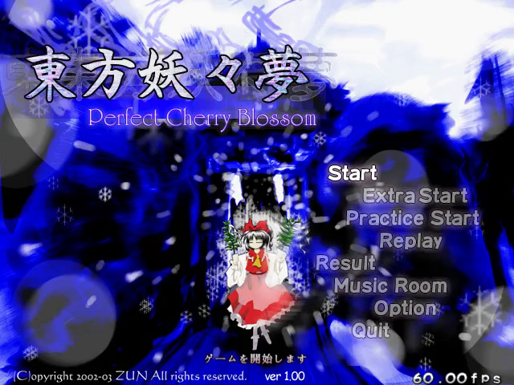
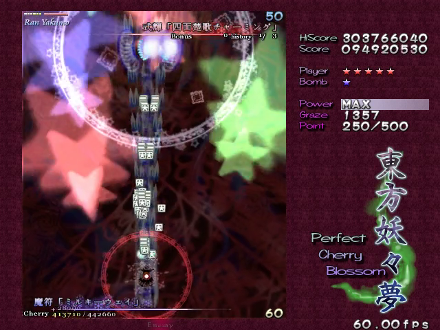
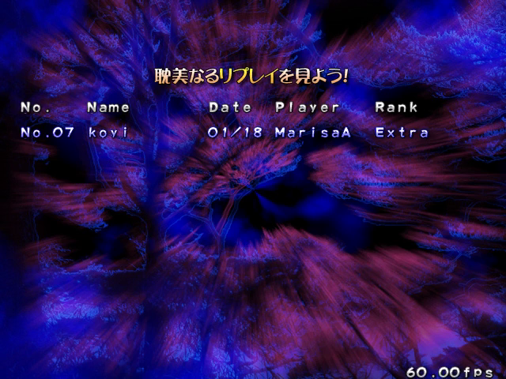
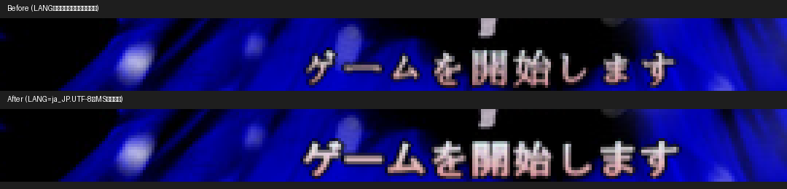

# フェーズ13: 録画品質の改善(タイトル画面録画・終了検知の再設計・フォント・マウスカーソル)

日付: 2026-07-15

## 背景

フェーズ12で処理落ち問題を解決した録画結果を確認したユーザーから、以下の要望・懸念が挙がった。

1. タイトル画面からの録画に対応したい
2. リプレイ終了検知を基準フレームとの差分比較で行う方式は、基準フレーム撮影失敗時に検知できない・全タイトルに対応できるか不明という懸念がある。以下を検証してほしい:
   - ログ監視間隔を50msではなく500msにしてスタッタリングが発生するか
   - 画面が一定時間変化しなければ終了とみなす方式は可能か
   - MOD側でリプレイ終了を検知してログ出力/プロセス終了する方式は可能か
3. 録画にマウスカーソルが映り込む問題の修正
4. 日本語フォントがWindows実機と異なる問題の修正(`games/assets/msgothic.ttc`を使用)

## 1. マウスカーソルの除去

ffmpegの`x11grab`に`-draw_mouse 0`を追加するだけで解決した。単純な修正のため詳細は割愛。

## 2. フォントの修正

`th07.exe`のバイナリを調査したところ、Shift-JISで`ＭＳ ゴシック`という文字列がハードコードされていることを確認した(GDIのフォント名指定と判断)。これまでは対応するフォントがWINEPREFIXに存在せず、Wineが代替として`IPAGothic`等にフォールバックしていたため、Windows実機と異なる見た目になっていたと考えられる。

`games/assets/msgothic.ttc`(実際のMS Gothic/MS PGothic/MS UI Gothicの3書体を含むTrueTypeコレクション、`fc-scan`で確認)を、使用中のWINEPREFIX(`prefixes/th07-wined3d-gl`)の`drive_c/windows/Fonts/`に配置し、レジストリ`HKLM\Software\Microsoft\Windows NT\CurrentVersion\Fonts`に以下を登録した:

```
"MS Gothic (TrueType)"="msgothic.ttc"
"MS PGothic (TrueType)"="msgothic.ttc"
"MS UI Gothic (TrueType)"="msgothic.ttc"
```

この時点ではダイアログテキスト等の見た目から「改善した」と判断したが、**これは誤りだった**。実際には画像アセット(ゲーム内蔵のビットマップ文字)とGDIで動的に描画される文字を混同しており、後半(セクション6)で判明した通りフォント自体は反映されていなかった。**この設定(フォントファイルの配置・レジストリ登録)自体は必要な作業ではあるが、これだけでは不十分だった**。**この設定はWINEPREFIXごとに個別に必要**なため、他のプレフィックス(`th07-wined3d-gl-b`、`th08-wined3d-gl`等)を今後使う場合は同様の作業が必要になる。

## 3. 録画開始タイミング問題の再調査(真因の訂正)

フェーズ12では「録画開始と同時に走る50ms間隔のログ監視タイトループ」が処理落ちの原因と結論していたが、今回さらに検証したところ、**この結論は不正確だった**ことが判明した。

### 検証1: ログ監視間隔を500msにしても同じ問題が再現

50ms→500msに間隔を緩めても、録画開始直後からメニュー自動操作前に録画を開始する構成では同様に重複率が悪化した(2〜6%ユニークのみ)。**ポーリング頻度は無関係**であることが確定した。

### 検証2: ファイルアクセスを完全に排除しても再現

Python側で一切ファイルアクセスをせず、単に`time.sleep()`で待つだけの構成にしても、メニュー自動操作前(タイトル画面出現直後)から録画を開始すると同様に悪化した(2〜7%ユニーク)。**Python側の処理は完全に無関係**と判明した。

### 検証3: ウィンドウ出現前からの静穏バッファも効果なし

ウィンドウがまだ存在しない(何もない画面)状態から録画を開始し、3秒・12秒の「静穏バッファ」を置いてからゲームを起動しても、いずれも改善しなかった(2〜9.5%ユニーク)。**単純な待機時間の長さでは解決しない**ことが分かった。

### 検証4(真因特定): ウィンドウが完全に安定してから録画を開始すると解決

MODのログで`WaitForStableWindow: stable`(ウィンドウの作成・再作成が完全に収まったことを示すログ)を確認してから録画を開始したところ、その後のメニュー自動操作・シーン遷移・リプレイ本編を通じて**全く問題が発生しなかった**(0-30秒区間で89.5%ユニーク、以降は99.9%以上)。

**真因は「録画(ffmpegのx11grab)のライフタイム中にウィンドウの作成・再作成イベントが発生すること」**であり、Python側のポーリングやファイルアクセスとは無関係だった。ウィンドウ作成・再作成というX11レベルのイベントが、x11grabの内部的なフレームタイミング確立を阻害し、一度崩れると録画終了まで回復しないと考えられる。フェーズ12での結論(ログ監視タイトループが原因)は、たまたま「ログ監視ループを行っている間=ウィンドウがまだ安定していない間」という時間的な相関を、因果関係と誤認したことによる誤りだった。

### 対策

`scripts/11_record_th07_replay_e2e.py`を、`WaitForStableWindow: stable`を検出してから録画を開始する構成に変更した。ウィンドウ安定確認(通常2.5秒程度)からリプレイ本編開始まで、タイトル画面・メニュー自動操作の様子も含めて全て録画できるようになった。

## 4. リプレイ終了検知方式の再設計

### 画面変化なし検知方式の実現可能性検証

基準フレームとの比較ではなく、**直前にポーリングしたフレームとの差分**を毎回比較し、差分が閾値を下回る状態が一定回数連続したら終了とみなす方式を検証した。基準フレームの事前撮影が不要になり、タイトル一覧画面のレイアウトを知らなくても機能する汎用的な方式。

フェーズ12で得た全編録画データ(830秒)を1秒間隔でサンプリングし、連続フレーム間のMADを分析したところ:

- ゲームプレイ中(終了直前30秒を除く)のMAD: 最小3.50、最大54.02、平均25.90
- 閾値10で「連続何秒static(MAD<10)だったか」を調べたところ、**ゲームプレイ中の最大連続static時間は9秒**(発生箇所はステージ導入ダイアログ画面、`reports/assets/th07_final_title_screen.png`と同様の静止テキスト画面)
- 一方、実際のリプレイ終了時は、一覧画面に復帰した瞬間からMADが0.0近辺に張り付き続ける

これにより、**閾値10・連続16秒(8回×2秒間隔)以上の静止で終了と判定する**設計であれば、ステージ導入ダイアログ等での誤検知を避けつつ確実に終了を検知できると判断した。猶予期間(グレースピリオド)も8秒→15秒に伸ばし、ダイアログ画面の最大9秒の静止に余裕を持たせた。

### MOD側でのリプレイ終了検知の実現可能性調査

以下を調査したが、いずれも本セッション(Linuxヘッドレス環境のみ)での実装は現実的でないと判断した:

- **`replayview.exe`のような専用ツールの活用**: th08には同梱されているが、**th07には存在しない**ため使えない
- **ゲーム内部メモリのリプレイ再生状態フラグを直接フックする方式**: 原理的には最も確実な方式だが、対象アドレスの特定にはCheat Engine等を使った動的メモリ解析が必要で、インタラクティブなWindows環境(本プロジェクトの「Windows実機開発」環境)での事前調査が要る。本セッションでは実施できなかった
- **`.rpy`ファイル自体を事前解析してステージごとのフレーム数を読み取り、再生時間を計算する方式**: `Fluorohydride/threp`等、th07を含む複数タイトルに対応した非公式デコーダーがコミュニティに存在することを確認したが、th06〜08世代の暗号化・圧縮フォーマットの詳細な解読には追加調査が必要で、本セッションでは実装に至らなかった

結論として、**今回は画面変化なし検知方式を採用**した。MOD側検知や`.rpy`解析による事前計算は、より確実な代替・補完手段として今後の課題とする。

## 5. 全修正を統合した最終検証

上記すべての修正(フォント・マウスカーソル除去・タイトル画面からの録画・画面変化なし検知)を統合した`scripts/11_record_th07_replay_e2e.py`で、`th7_07.rpy`の全編録画を実行した。

- 総録画時間: 851.3秒(約14.2分、タイトル画面〜メニュー自動操作の約6秒を含む)
- **全51063フレーム中48408枚がユニーク(94.8%)**、処理落ちの再発なし
- 画面変化なし検知は正常に機能し、リプレイ一覧画面(No.07選択状態)への復帰を正しく検知して停止した
- 出力: 640x480/h264/60fps、aac/48000Hz/stereo、`mean_volume: -9.3dB`
- 目視確認: タイトル画面からの録画(下図)、マウスカーソルの映り込みなし、ボス戦(八雲藍、MilkyWay)の滑らかな描画、終了検知の正確さを確認した(**フォントについては、この時点ではまだ正しく反映されていなかったことがセクション6で判明した**)





## 6. フォント修正の再調査(真因の訂正)

ユーザーによる目視確認の結果、セクション2の対応後も**動的に描画される日本語テキスト(画像アセットではなくGDI経由で描画される文字。タイトル画面では下部の「ゲームを開始します」のみが該当)がMS Gothicになっていない**との指摘を受けた。

### 調査

`WINEDEBUG=+font`でWineのフォント関連トレースを取得したところ、以下が判明した。

- `msgothic.ttc`は正しくロードされ、`fontTools`でフォントファイル自体を確認しても`ＭＳ ゴシック`という日本語名(`nameID=1, platformID=3, langID=0x411`)が正しく格納されている
- しかしWineはこのフォントを英語名`MS Gothic`のfamilyとしてのみ内部登録しており、ゲームが`CreateFont`で日本語名`ＭＳ ゴシック`を指定しても直接は一致しない
- さらに致命的な問題として、ゲームが`CreateFontA`(ANSI版API)にShift-JISでエンコードした`ＭＳ ゴシック`を渡す際、**WineプロセスのANSI→Unicode変換が正しく行われず、フォント名自体が文字化けしていた**(ログ上は`L"\201al\201ar \0192S\0192V\0192b\0192N"`のような不正な文字列になっていた)。原因は、使用中のWINEPREFIX(`prefixes/th07-wined3d-gl`)が**英語(米国)ロケールで初期化されていた**ことだった(`user.reg`の`Control Panel\International`に`iCountry=1`(米国)が記録されている)。これによりANSIコードページがShift-JIS(cp932)にならず、日本語のマルチバイト文字列が正しく解釈されなかった。ウィンドウタイトル(`“Œ•û—dX–²@`...`のような文字化け)も同じ原因だった

### 対策

`scripts/11_record_th07_replay_e2e.py`でwineプロセスを起動する際の環境変数に`LANG=ja_JP.UTF-8`・`LC_ALL=ja_JP.UTF-8`を追加した。これにより、ANSI→Unicode変換が正しくShift-JISとして行われるようになり、フォント名の文字化けが解消され、ウィンドウタイトルも`東方妖々夢　～ Perfect Cherry Blossom. ver 1.00`と正しく表示されるようになった。

修正前後で「ゲームを開始します」テキストを拡大比較し、修正後はMS Gothic特有の角ばった太めの字形になっていることを確認した(下図、ユーザー本人による目視確認済み)。なお、セクション2で行った`FontSubstitutes`レジストリへの日本語名→英語名マッピング追加(`"ＭＳ ゴシック"="MS Gothic"`等)も、文字化けが解消された後にWineが正しくフォント名を照合するために必要な補助的対応として有効に機能している。



## 教訓

- **ffmpegの`x11grab`は、対象領域内でウィンドウが作成・再作成されるイベントが録画のライフタイム中に発生すると、その後の録画全体が重複フレームだらけになる**。Python側のポーリング頻度やファイルアクセスの有無は無関係。録画は、対象ウィンドウの作成・再作成が完全に収まった(MODのログで`WaitForStableWindow: stable`を確認できる)後に開始すること。この教訓は`AGENTS.md`のフェーズ12関連の記述を訂正・更新した
- リプレイ終了検知は、基準フレーム比較よりも「直前フレームとの差分が一定時間続けて小さいこと」を見る方式の方が、事前準備(基準フレーム撮影)が不要で汎用性も高く、堅牢である
- **WINEPREFIXが英語ロケールで初期化されていると、日本語アプリのANSI文字列(フォント名・ウィンドウタイトル等)のUnicode変換が正しく行われず文字化けする**。フォントファイルの配置・レジストリ登録だけでは不十分で、`LANG=ja_JP.UTF-8`のようにロケールも明示する必要がある。文字化けは一見「フォントが違うだけ」に見えるため、原因の切り分けを誤りやすい(本レポートでも一度誤った結論に達した)。`WINEDEBUG=+font`でのトレース確認が原因特定に有効だった

## 成果物

- 修正版スクリプト: `scripts/11_record_th07_replay_e2e.py`
- 検証用録画: `runs/th07_final_all_fixes/video.mp4`(851.3秒、640x480/60fps、音声付き、重複率5.2%。ただしこの録画自体はフォントのロケール修正前のもの)
- WINEPREFIX `prefixes/th07-wined3d-gl`にMS Gothicフォントを導入・`FontSubstitutes`registry登録(`.gitignore`対象のためリポジトリには含まれない。再現手順は本レポート参照)
