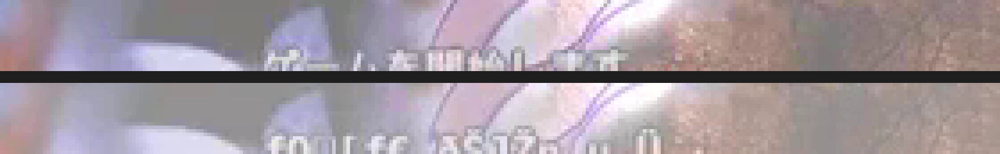
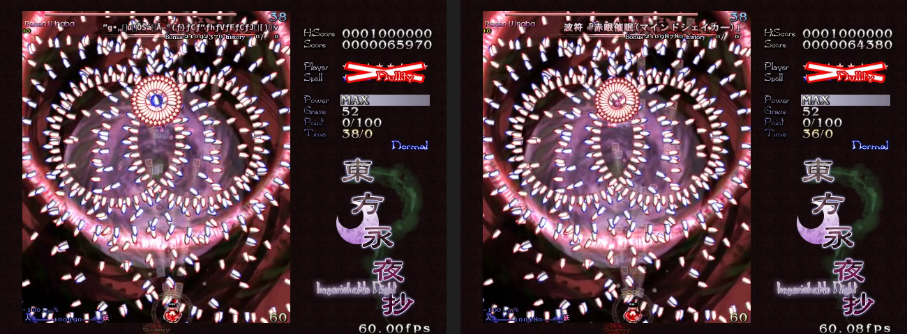

# フェーズ29: th08本番録画の日本語文字化けの原因特定(Dockerイメージのフォント欠落)

日付: 2026-07-23

## 背景

本番サービスで`games/th08_ver100d/replay/th8_02.rpy`(スペルプラクティスモード、約1.5分)を録画したところ、日本語文字列が文字化けしていることが報告された。まずローカル最新環境(`scripts/23_record_th08_ver100d_replay_e2e.py` + `prefixes/th08-wined3d-gl`)で同一リプレイを録画したところ、**文字化けは再現しなかった**(フォントがMS Gothicと異なる見た目にはなっているが、文字自体は正しく読める)。この時点で「文字化けはAWS/本番環境固有の問題」と考えられたため、ローカルのDocker環境で本番と同一のイメージを再現して原因を切り分けた。

## 仮説

`prefixes/th08-wined3d-gl/system.reg`の`[...\CurrentVersion\Fonts]`キーには、CJKフォールバック用フォントとして以下のような**このリポジトリの開発機(ホストマシン)の絶対パス**を指すエントリが多数登録されている(wineboot実行時にホストのfontconfigをスキャンして生成されたもの):

```
"@IPA\x30b4\x30b7\x30c3\x30af (TrueType)"="Z:\\usr\\share\\fonts\\opentype\\ipafont-gothic\\ipag.ttf"
"@AR PL UMing CN (TrueType)"="Z:\\usr\\share\\fonts\\truetype\\arphic\\uming.ttc"
"@WenQuanYi Zen Hei (TrueType)"="Z:\\usr\\share\\fonts\\truetype\\wqy\\wqy-zenhei.ttc"
...
```

これらはいずれも`fonts-ipafont-gothic`・`fonts-ipafont-mincho`・`fonts-arphic-uming`・`fonts-droid-fallback`・`fonts-wqy-zenhei`等の**開発機に個別にaptインストールされたパッケージ由来**のフォントファイルである。一方、`cloud/docker/aws/Dockerfile.th08`(および`Dockerfile`, `Dockerfile.multigame`)がインストールするパッケージ一覧には、これらCJKフォントパッケージが**1つも含まれていない**(`language-pack-ja`はロケールデータのみでフォントは含まない)。

`COPY prefixes/th08-wined3d-gl/ /app/prefixes/th08-wined3d-gl/`によってWINEPREFIXの実体(このホスト由来のフォント参照込みのレジストリ)がそのままDockerイメージに焼き込まれるため、**コンテナ内には日本語グリフを持つフォントが実質的に1つも存在しない状態でth08.exeが起動している**可能性が高いと仮説を立てた。

## 検証

### 1. コンテナ内のフォント環境確認

```
$ docker run --rm --entrypoint bash th08-mojibake-repro:local -c "dpkg -l | grep -iE 'ipafont|arphic|droid|wqy|noto'"
(該当パッケージなし)

$ docker run --rm --entrypoint bash th08-mojibake-repro:local -c "fc-list | wc -l"
113  (全て英語圏フォント。IPA/Arphic/Droid/WQY/Noto CJK系は皆無。"URW Gothic"は西欧書体で日本語グリフとは無関係)
```

ホスト側では`fonts-arphic-uming`・`fonts-droid-fallback`・`fonts-ipafont-gothic`・`fonts-ipafont-mincho`・`fonts-wqy-zenhei`がいずれも`ii`(インストール済み)だが、コンテナ内には皆無であることを確認した。

### 2. 本番と同一Dockerイメージでの実機録画

`cloud/docker/aws/Dockerfile.th08`をローカルでビルドし(`docker build -f cloud/docker/aws/Dockerfile.th08 -t th08-mojibake-repro:local .`)、entrypointを介さず`scripts/23_record_th08_ver100d_replay_e2e.py --replay th8_02.rpy`をコンテナ内で直接実行して同一リプレイを録画した(Xvfb・pulseaudioともにコンテナ内で完結、重複フレーム率7.9%で録画自体は正常)。

タイトル画面下部に表示される、GDIで動的に描画される文字列(「ゲームを開始します」。画像アセットではなくフォント経由で描画される数少ない文字列の一つ。フェーズ13参照)を比較した結果:



- **ホスト直接実行**: 「ゲームを開始します」と正しく読める(書体はMS Gothicではないが、文字としては正常)
- **Dockerコンテナ内**: 意味不明な記号の羅列に文字化けしている(ユーザー報告と一致する見た目)

同一のWINEPREFIX・同一のスクリプト・同一のリプレイファイルで、**コンテナ内で実行した場合にのみ文字化けが再現した**ため、原因はAWS環境(EC2インスタンスやネットワーク等)固有の何かではなく、**DockerイメージにCJKフォントが一切同梱されていないこと**だと結論づけた。

## 結論

- 文字化けの真因は「AWS環境固有の問題」ではなく、**`cloud/docker/aws/Dockerfile.th08`(および`Dockerfile`, `Dockerfile.multigame`)にCJKフォントパッケージが1つもインストールされておらず、かつWINEPREFIX(`prefixes/th08-wined3d-gl`)のフォントレジストリが開発機ローカルのフォントファイルパスに依存している**こと。AWS上で発生していたのは、たまたま本番デプロイ経路がこのDockerイメージを使っていたためであり、ローカルでも同じDockerイメージ経由で実行すれば同様に再現する
- フェーズ13で判明した「WINEPREFIXがGDIフォント名を正しく解決するにはロケール(`LANG=ja_JP.UTF-8`)の設定が必要」という問題は`scripts/23`側で既に対応済みで、これ自体は今回の文字化けの原因ではない(ロケールの問題と実際に利用可能なフォントの問題は別軸)
- なお、ローカルホストでの録画でも「ゲームを開始します」はMS Gothicではなく代替のCJKフォント(おそらくIPA Gothic等)で描画されており、フェーズ13で th07-wined3d-gl に対して行った`msgothic.ttc`の配置・`FontSubstitutes`レジストリ登録は**th08-wined3d-glには未実施**であることも確認した(`AGENTS.md`に記載の既知の未対応事項)。これは見た目の書体の違いに留まり文字化けの原因ではないが、本番の見た目をWindows実機に近づけるなら合わせて対応が望ましい

## 修正

`prefixes/th08-wined3d-gl`に対して、フェーズ13で`th07-wined3d-gl`に行ったのと全く同じ対応を実施した(`th07`との差分がゼロになったことを`diff`で確認済み)。

1. `games/assets/msgothic.ttc`(実際のMS Gothic/MS PGothic/MS UI Gothicを含むTrueTypeコレクション)を`prefixes/th08-wined3d-gl/drive_c/windows/Fonts/msgothic.ttc`に配置
2. `wine reg add`でレジストリを登録:
   - `HKLM\Software\Microsoft\Windows NT\CurrentVersion\Fonts`に`"MS Gothic (TrueType)"`・`"MS PGothic (TrueType)"`・`"MS UI Gothic (TrueType)"`=`"msgothic.ttc"`
   - `HKLM\Software\Microsoft\Windows NT\CurrentVersion\FontSubstitutes`に日本語名`"ＭＳ ゴシック"`→`"MS Gothic"`のマッピング

**この修正はDockerfile側の変更(apt CJKフォントパッケージの追加)を一切必要としない**。`msgothic.ttc`はWINEPREFIX自体(`drive_c/windows/Fonts/`)に格納されるため、`COPY prefixes/th08-wined3d-gl/`で自動的にDockerイメージに含まれる。フェーズ29冒頭で見つけた「ホスト機のフォントパスに依存する`@...`エントリ」はあくまでフォールバック用の副次的な仕組みであり、GDIが最初に参照する`FontSubstitutes`→`Fonts`の解決チェーンさえ自己完結していれば、外部フォントパッケージへの依存なしに正しく描画されることが判明した。

### 修正の検証

修正後のWINEPREFIXを含めて本番と同一の`Dockerfile.th08`を再ビルドし(`th08-mojibake-repro:fixed`)、同一のth8_02.rpyをコンテナ内で録画して修正前後を比較した。

タイトル画面の「ゲームを開始します」:


スペルプラクティス中のスペルカード名表示(文字化けが最も顕著だった箇所):



- 修正前: `"g・,」しU0SA|A~°{f}fCf''fhfVfFfCf」{|)}V` のような完全な記号の羅列
- 修正後: `波符『赤眼催眠(マインドシェイカー)』` と正しく表示

重複フレーム率も3.9%(修正前は7.9%)と良好で、フォント修正が録画品質に悪影響を与えていないことも確認した。

## 今後の対応

- ローカルの`prefixes/th08-wined3d-gl`は修正済みだが、**AWS本番で使われているECR上のDockerイメージ自体はまだ再ビルド・再デプロイされていない**。本番反映には、修正後の状態でイメージを再ビルドし、ECRへのpush・(必要であれば)稼働中タスク定義の更新を行う必要がある(これはAWSへの実デプロイ操作のため、実施前に別途確認する)
- `th07-wined3d-gl`は元からこの対応済みだったため、th07側の本番録画は今回の問題の影響を受けていないと考えられる
