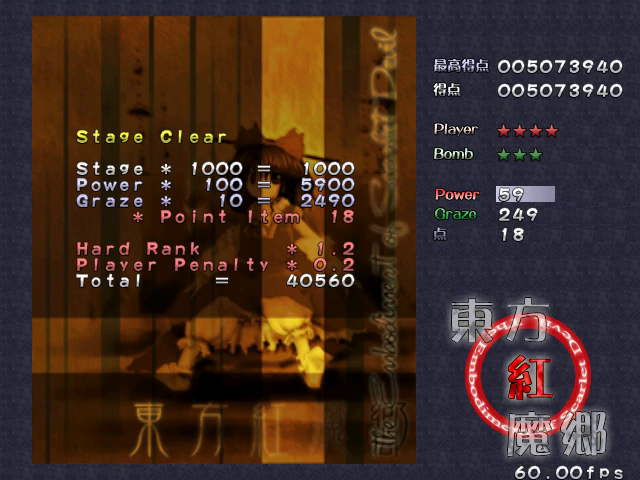

# フェーズ33: リプレイ終了検知の誤検知修正(ステージ間リザルト画面の長時間静止対策)

日付: 2026-07-24

## 背景

本番サービスのリリース前テストで、th06のリプレイ`games/th06/replay/th6_ud1vfq.rpy`を録画したところ、**ステージ4クリア後、ステージ5開始前に「画面静止=リプレイ終了」と誤検知され、録画がリプレイ本編の途中で停止する**事象が報告された。ステージ4のリザルト画面が長く表示されたことが原因と推測された。

調査を簡便にするため、ユーザーからステージ1のリザルト画面を長く表示するよう調整したテストリプレイ`games/th06/replay/th6_04.rpy`が提供された。ユーザーからは「この問題はth06に限らず他タイトルにも存在しうる」との指摘もあり、汎用的な改善を検討することが求められた。

## 既存ロジックの構造的な問題

`scripts/25_record_replay_e2e_multigame.py`の終了検知(フェーズ13/14で設計)は、直前フレームとのMAD(平均絶対誤差)が閾値(`STILL_MAD_THRESHOLD=2.0`)を下回る状態が`STILL_CONSECUTIVE_REQUIRED`(8回=16秒)連続したら「リプレイ終了」とみなす、という純粋に画面の静止時間だけを見る方式だった。

しかし、実際にリプレイが完全に終了して自動的に戻る「リプレイ選択画面」と、**ステージクリア後に一時的に表示される「Stage Clear」等のリザルト画面**は、どちらも入力なしで画面がぴったり静止する(MAD≈0.0)という点で区別がつかない。閾値をどれだけ長く取っても、それを超える長さのリザルト画面停留が録画対象のリプレイに含まれていれば同じ問題が再発する、という構造的な脆弱性があった。

## 調査: th6_04.rpyによる再現

`scripts/25`の`STILL_CONSECUTIVE_REQUIRED`を一時的に無効化した調査用コピーで`th6_04.rpy`を実行し、MAD値の推移を実測した。

| elapsed(秒) | MAD | 備考 |
|---|---|---|
| 22.3〜163.7 | 5〜45 | ステージ1プレイ中(変動あり) |
| 165.9〜179.5 | 0.00 | **静止(Stage Clear画面)。7回連続(14秒)** |
| 181.8〜 | 24.57など | ステージ2開始、プレイ再開 |

既定の閾値(8回=16秒)にはわずかに届かなかったものの、実際の`th6_ud1vfq.rpy`(ステージ4)ではこの静止がより長く続き閾値を超えたと考えられる。elapsed=183s付近のフレームを動画から抽出したところ、以下の「Stage Clear」リザルト画面であることを確認した。

これは、th06が実際にリプレイ終了時に戻る「リプレイ選択画面」(`reports/assets/th06_e2e_replay_end.png`、フェーズ31で確認済み)とは全く見た目の異なる画面であり、両者を機械的に区別することが可能なはずだと確認できた。

th07(`reports/assets/th07_e2e_replay_end_detected.png`)・th08(本フェーズで新規取得)についても、リプレイ終了時に同じ構造(タイトル文言+「No. Name Date Player Rank」の列見出し+リプレイ一覧)を持つ「リプレイ選択画面」に自動的に戻ることを確認しており、**この誤検知はth06に限らずth07/th08にも起こりうる構造的な問題**であることが分かった。

## 対応: リプレイ選択画面テンプレートとの照合を追加

画面静止という条件に加えて、**静止した画面が実際に「リプレイ選択画面」であるかをテンプレートマッチングで確認し、両方満たした場合のみ終了と判定する**方式に変更した(`scripts/25_record_replay_e2e_multigame.py`)。

- `assets/replay_end_templates/{th06,th07,th08}.png` にゲームごとのリプレイ選択画面の参照画像を配置(th06/th07は過去の実録画フレーム`reports/assets/*_replay_end*.png`を流用、th08は本フェーズで`--record-seconds`を使った短時間録画中のメニュー遷移(Replay確定直後、1件目選択前の一覧表示)から新規取得)
- 参照画像は`grab_frame`と同じ160x120グレースケールにダウンサンプルした上で、リプレイ内容(一覧の中身)に依存しない上部の帯(タイトル文言+列見出し行、`END_TEMPLATE_ROWS=40`)だけを切り出して比較する
- 静止検知(`consecutive_still >= STILL_CONSECUTIVE_REQUIRED`)が成立した時点で、その帯領域を参照画像とMAD比較し、`END_TEMPLATE_MAD_THRESHOLD`(15.0)未満なら終了と確定、そうでなければ「終了とみなさず監視を継続」してconsecutive_stillをリセットする
- テンプレート未設定・未存在のゲームは従来通り静止のみで判定する(フォールバック。新規タイトル追加時にテンプレート未整備でも動作は壊れない)

閾値15.0の根拠(実測値):

| 比較 | MAD |
|---|---|
| th06テンプレート同士(自己一致) | 0.00 |
| th06テンプレート vs 無関係な画面(Extraボス戦、デモ画面、タイトル) | 41.7〜141.9 |
| th06テンプレート vs 本件の誤検知フレーム(Stage Clear画面) | **49.2** |
| th08テンプレート同士(自己一致) | 0.00 |
| th08テンプレート vs th08タイトルデモ画面 | 75.7 |

自己一致(0.0)と無関係画面(40台以上)の間に大きなマージンがあり、15.0という閾値で安全に分離できる。

## 検証

修正後の`scripts/25`を実際に`th6_04.rpy`で実行し、以下を確認した。

1. **既定の閾値のまま**(`--quick-classify-sec 220`で強制的に220秒まで監視継続): ステージ1リザルト画面の静止(elapsed 165.9〜179.5s)を経て、220秒まで誤って停止することなく録画が継続し、`quick classify`で正常終了と判定された。
2. **`STILL_CONSECUTIVE_REQUIRED`を5(10秒)に下げた検証版**(本件の静止時間14秒が確実に閾値を超えるように調整): elapsed=175.0sで静止検知が発火し、ログに`画面静止を検知。リプレイ選択画面テンプレートとの差分 MAD=50.38`→`画面は静止していますがリプレイ選択画面とは一致しないため、終了とみなさず監視を継続します`が出力され、**誤って停止せずステージ2(elapsed=181.8s、MAD=24.57)へ正常に継続した**ことを確認した。

2番目の検証により、テンプレート照合ロジックが意図通りに機能し、閾値を問わず本件の誤検知パターンを正しく回避できることを直接確認できた。

## 今後の課題

- 本修正はth06/th07/th08の3タイトルにテンプレートを用意したが、今後新規タイトルを追加する際は同様に`assets/replay_end_templates/{game}.png`を用意すること(未整備の場合は警告ログを出しつつ従来の静止のみ判定にフォールバックする)
- 今回はth06のテンプレートのみを実際のフルパイプラインで最後まで検証した(th07/th08はテンプレート自体の分離性のみ確認、実際の誤検知回避シナリオでのE2E検証は未実施)
- `END_TEMPLATE_MAD_THRESHOLD`(15.0)は現時点のテンプレート画像における実測マージンに基づく初期値であり、将来的にリプレイ選択画面のレンダリングが変化する状況(解像度変更、フォント差し替え等)があれば再検証が必要
