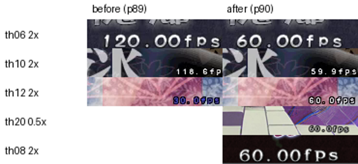

# フェーズ90: 倍速録画時の画面上fps表示の修正(th06/th08/th10/th12/th20)と、th06cの倍速録画検証

## 背景と目的

reports/89で倍速録画を全タイトルへ展開したが、録画を見ると画面上のfps表示が「等倍に戻したあとのfps」(60fps)にならないタイトルがあった。

| タイトル | 2倍速での表示(reports/89) |
|---|---|
| th06 | 120.00fps |
| th08 | 120.00fps |
| th10 | 118.6fps前後 |
| th12 | 30.0fps |
| th20 | 30.0fps |

本フェーズでは(1) reports/48と同じ手法(fps計算に使われているタイマー呼び出しだけを偽装する`fps_display_hook`)でこれを直し、(2) reports/89で対象外にしていたth06cの倍速録画をg6f.2xlargeで検証した。

## 1. fps表示の修正

### 1.1 原因

exeを`pefile`+`capstone`で逆アセンブルし、fps書式文字列(`%.02ffps`/`%2.1ffps`)を参照する関数と、その関数が使うタイマーAPIの呼び出し元を洗い出した(使い捨てスクリプト、手順は§1.4)。原因は3種類あった。

| タイトル | fps計算の時刻源 | 2倍速で表示がずれた理由 |
|---|---|---|
| th12 / th20 | QueryPerformanceCounter(th12は戻り先RVA `0x508e8`、th20は`0x1cb54`。reports/48・64で特定済み) | **二重掛け**。`speed_hack_hook`がQPCを2倍に伸ばした値を、さらに`fps_display_hook`が`FPS_LIMIT_TARGET_HZ/60`=2倍に伸ばしていた(ゲームには時間が4倍で進むように見え、120÷4=30fps) |
| th06 / th08 | **timeGetTime**(th06: 戻り先RVA `0x23f63`(初回の基準時刻)と`0x23f6e`(毎フレーム)、th08 ver1.00d: `0x46fad`と`0x46fb8`) | `speed_hack_hook`はQPCしか偽装しない(既定の`SPEED_HACK_TIMERS=qpc`)ので、fps計算は実時間のまま(120fps) |
| th10(と、th06) | VsyncPatch(`vpatch.ini`の`CalcFPS = 1`)が**自前の実時間タイマーでfpsを計算して表示** | exe側の偽装が表示に届かない。th10本体のfps計算(RVA `0x134b0`が`0x39540`経由でQPCを読む)はQPC偽装が効く |

th06/th08のfps計算は、どちらも「初回だけ基準時刻を取り、毎フレーム現在時刻との差が500ms以上になったら `フレーム数/経過秒` を計算して基準を更新する」構造(th06: RVA `0x23f3f`〜`0x23ff9`、th08: `0x46f8e`〜`0x4703b`)。

なおth10本体のfps計算には「fpsが65を超える状態が4回続いたらQPCを信用せずtimeGetTimeへ切り替える」処理がある(RVA `0x134fa`〜`0x13542`で`[0x492508]`(QPC周波数)をゼロクリア)。QPCを偽装したうえでfpsが60付近に収まるので、この切り替えは起きない。

### 1.2 修正

- `mods/common/fps_display_hook.cpp/.h`
  - 補正倍率を `FPS_LIMIT_TARGET_HZ/60` から、**対象APIを`speed_hack_hook`が偽装している場合は`SPEED_HACK_MULTIPLIER`で割った値**に変更(`ComputeDisplayScale()`)。QPC版は倍率≠1なら常に偽装済み、timeGetTime版は`SPEED_HACK_TIMERS`に`tgt`を含むときのみ偽装済みとみなす(`speed_hack_hook.cpp`と同じ判定)。2倍速では QPC版=120/60/2=1.0(無補正、ゲームの計算がそのまま60を出す)、timeGetTime版=2.0。低速録画(30Hz、倍速無し)は従来通り0.5。
  - 対象呼び出し元を最大4つ指定できるオーバーロード(`InstallFpsDisplayCorrectionHook(const ULONG_PTR*, int)`・`InstallFpsDisplayCorrectionHookTimeGetTime(const ULONG_PTR*, int)`)を追加。基準時刻と現在時刻を別の`call`で取るth06/th08のため(両方を同じ写像で偽装しないと初回の差分が狂う)。
  - `InstallSpeedHackHook()`の**後**に呼ぶこと(IATの外側に来てreturn addressで呼び出し元を判定できるように)をヘッダに明記。既存のth09/th12/th20はこの順序になっている。
- `mods/th06_replay_autoplay/dllmain.cpp`: `InstallFpsDisplayCorrectionHookTimeGetTime({0x23f63, 0x23f6e})`を追加。
- `mods/th08_replay_autoplay/dllmain.cpp`: `InstallFpsDisplayCorrectionHookTimeGetTime({0x46fad, 0x46fb8})`を追加。
- `recorder/instance.py` `_apply_vpatch_game_fps()`: 等倍以外では`GameFPS`に加えて`CalcFPS = 0`を書き込む(等倍では1のまま)。th06はゲーム本来の計算(timeGetTime、上記のフックで補正)、th10はゲーム本来の計算(QPC、speed_hack_hookで補正済み)に戻る。
- `recorder/pipeline.py`: ウィンドウ検出(`WINDOW_TIMEOUT_SEC`=20秒)とthpracアタッチ(60秒)のタイムアウトを倍速時に短縮しないよう`max(元の値, scale_seconds(元の値))`に変更。2倍速では10秒に縮み、ローカルのth10で起動が間に合わず「ゲームウィンドウが検出できませんでした」で1回失敗したため(起動処理は実時間で進むので、縮める理由が無い)。

### 1.3 検証(ローカル、Xvfb・CPU描画)

ビルドは`mods/common/build_mingw.sh <title>`(th06/th08/th09/th12/th20)。録画は`/tmp/p90/run_local.sh`相当の手順で、

```bash
export FPS_LIMIT_TARGET_HZ=120 SPEED_HACK_MULTIPLIER=2
python3 scripts/25_record_replay_e2e_multigame.py --game <title> --record-seconds 60 \
  --output /mnt/cache3/sattori-speedup-local-p90/<title>_2x.mp4
```

th20はCPU描画では2倍速が出ない(FpsMonitor 47Hz、メニュー操作も失敗)ため、ユーザー提案どおり**0.5倍速**(`FPS_LIMIT_TARGET_HZ=30 SPEED_HACK_MULTIPLIER=0.5`、`--thprac --record-seconds 90`)で検証した。0.5倍速でもQPCはspeed_hack_hookで0.5倍に偽装されるので、2倍速と同じ「割り戻し」の経路(補正倍率 0.5/0.5=1.0)を通る。

| タイトル | 条件 | FpsMonitor | ログの補正倍率 | 画面表示 |
|---|---|---|---|---|
| th06 | 2倍速 | 120.0Hz | tgt scale=2.0(n=2) | **60.00fps** |
| th08 | 2倍速 | 120.1Hz | tgt scale=2.0(n=2) | **60.00fps** ※1 |
| th10 | 2倍速 | 119.7Hz | (CalcFPS=0のみ) | **60.0 / 59.9fps** |
| th12 | 2倍速 | 119.9Hz | QPC scale=1.0 | **60.0fps** |
| th20 | 0.5倍速 | 30.0Hz | QPC scale=1.0 | **60.0fps** |

※1 Xvfb上のth08はWin32のタイトルバー分だけ映像がずれ、fps表示のある最下行が録画から切れる(reports/89 §5.3と同じ現象。`--capture-window-id`でも同じ)。録画と並行してルートウィンドウを10秒ごとに保存(`ffmpeg -f x11grab -i :99 -frames:v 1`)して確認した(`/mnt/cache3/sattori-speedup-local-p90/th08_2x_r3_root60s.png`)。



AWS(g6f.2xlarge、GPU描画+NVENC、§2と同じインスタンス)でも2倍速の短尺録画(`--record-seconds 90`、th20は`--thprac --record-seconds 120`、th08は`--capture-window-id`)で確認した。全タイトル試行1回目で成功。

| タイトル | FpsMonitor 中央値/最小 | 重複率 | 画面表示 |
|---|---|---|---|
| th06 | 120.0 / 119.9Hz | 1.9% | 60.00fps |
| th08 | 120.1 / 119.9Hz | 0.4% | 60.00fps |
| th10 | 119.9 / 119.6Hz | 0.4% | 60.0fps |
| th12 | 119.9 / 119.6Hz | 0.3% | 60.0fps |
| th20 | 119.7 / 112.3Hz | 1.4% | 60.0fps |

(FpsMonitorは起動直後の3区間を除く5秒区間の値。)

録画は`/mnt/cache3/sattori-<title>-verify/phase90_fps_display/fps_<title>_2x.mp4`。

### 1.4 逆アセンブル手順(再現用)

`scripts/90_find_fps_timer_callsites.py`(新規)で、fps書式文字列を参照する命令と、タイマーAPIのIATを参照する命令(戻り先RVA付き)をアドレス順に列挙する。

```bash
python3 scripts/90_find_fps_timer_callsites.py games/th06/東方紅魔郷.exe
#   TIMER timeGetTime ins_rva 0x23f5d ret_rva 0x23f63 ...
#   TIMER timeGetTime ins_rva 0x23f68 ret_rva 0x23f6e ...
#   FPSREF 0x23fef push 0x46b724
python3 scripts/90_find_fps_timer_callsites.py games/th06/東方紅魔郷.exe --disasm 0x23f3f 0x24000
```

fps文字列を`push`する命令を含む関数を読み、そこで(または、そこから呼ぶ時刻取得関数で)使われているタイマー呼び出しの戻り先RVAを`fps_display_hook`の対象にする。th10のように書式文字列の直前で`call`している関数(`0x134b0`)の中で時刻取得関数(`0x39540`)を経由する場合もあるので、`--disasm`で辿る。

## 2. th06cの倍速録画

### 2.1 MODの対応

th06cはth06ncと同じDXライブラリ製の64bitエンジンなので、th06nc(reports/89)と同じ仕組みを`mods/th06c_replay_autoplay/dllmain.cpp`へ移植した。

- `MyGetProcAddress`(既存の入力注入用フック)で`QueryPerformanceCounter`→`WrapQueryPerformanceCounterForSpeedHack()`、`timeGetTime`→`WrapTimeGetTimeForSpeedHack()`、`DirectSoundCreate8`→`WrapDirectSoundCreate8()`、`CoCreateInstance`→`MyCoCreateInstance`に差し替え。
- `MyCoCreateInstance`で`CLSID_MMDeviceEnumerator`なら`HookMMDeviceEnumerator()`(WASAPIのレート偽装・同期マーカー)、`CLSID_DirectSound(8)`なら`HookDirectSoundObject()`。ole32のIATの`CoCreateInstance`もフックを試みる(th06c.exeはIATに持たずFAILEDになるが、GetProcAddress経由で捕捉できる)。
- DllMainで`InstallSpeedHackHook()`・`InstallWasapiHook(1.0)`。
- `mods/th06c_replay_autoplay/build_mingw.sh`に`dsound_hook.cpp`・`speed_hack_hook.cpp`・`wasapi_hook.cpp`と`-lole32`を追加。

ローカル(Xvfb・CPU描画、`--record-seconds 60`)の2倍速で、th06cも**音声はWASAPI**(`CoCreateInstance: clsid={BCDE0395-...}`、`WASAPI GetMixFormat: 88200 Hz -> ゲームには 44100 Hz と見せる`)、QPCは`GetProcAddress`経由で取得され偽装が効くこと、FpsMonitor 121〜125Hz(th06cの入力ポーリングは等倍でも61Hz前後で、フレーム数と1対1ではない)、同期マーカーの注入成功を確認した。画面上のfps表示はQPC由来なので追加の補正なしで60fps前後になる(1〜4倍速とも60.00〜60.15fps)。

### 2.2 AWSでの録画(g6f.2xlarge、GPU描画+NVENC)

| 項目 | 値 |
|---|---|
| インスタンス | g6f.2xlarge スポット(us-west-2a、`<INSTANCE_ID>`、スポット要求`<SPOT_REQUEST_ID>`)。2c/2d/2bは容量不足。**検証後にterminate、スポット要求cancel、キーペア`touhou-recorder-p90-key`も削除済み** |
| AMI・構築 | reports/89と同じ(`<AMI_ID>`、`scripts/89_setup_gpu_instance.sh`、GRID 595.91.07、`NVIDIA L4-6Q`) |
| 転送 | リポジトリ(`cloud/`・`runs/`・`instances/`・`games/*`・`prefixes/*`を除く)と、`games/`・`prefixes/`のth06c/th06/th08_ver100d/th10/th12/th20をrsync(計約6.5GB、約15分) |
| 録画 | `scripts/89_run_speedup_batch.sh`、`EXTRA_ARGS="--gpu-display --gpu-encode"`。§1.3のfps確認も同じインスタンスで実施 |

構築時の注意: SSH経由で`89_run_speedup_batch.sh`を起動したところ、systemdユーザーの`pulseaudio.socket`(`enable-linger`で有効になる)と、スクリプトが`setsid nohup`で起動するpulseaudioが競合し、`pactl`が`Connection refused`になった(sinkの作成で録画が即失敗)。`systemctl --user mask pulseaudio.socket pulseaudio.service`、`pkill pulseaudio`、`rm -rf /run/user/1001/pulse`のうえで手動起動し直すと解消した。reports/89では起きていない(再現条件は未確認)。

結果(th6_01.rpy=Hard全6面、記録スコア114,250,700。th6_04.rpy=Extra、84,613,650)。「落ち」は等倍へ復元後(`scripts/47_descale_th20_slowmo.py --target-hz 60N`)の落ちフレーム(`scripts/81_analyze_stutter_periodicity.py`、15秒〜末尾45秒手前)。集計は`scripts/89_summarize_speedup.py`。

| 条件 | 試行 | FpsMonitor 中央/下位5% | CPU(8vCPU) | GPU sm/enc | 重複率 | 復元後の落ち | 周期性 | スコア | 録画実時間 | マーカー比/残差 |
|---|---|---|---|---|---|---|---|---|---|---|
| Hard 等倍 | 1 | 61.1/60.0 | 7.9% | 5/1% | 0.0% | 341=0.4% | 3.88s/R=0.36 | 一致 | 1552s | 128/+1.0ms |
| Hard 2倍速 | 1 | 123.7/121.3 | 12.5% | 11/2% | 2.1% | 877=1.0% | 1.78s/R=0.12 | 一致 | 815s | 351/+0.3ms |
| Hard 3倍速 | 1 | 186.6/183.6 | 17.1% | 15/4% | 2.8% | 3067=3.4% | R=0.07 | 一致 | 533s | 354/-0.6ms |
| Hard 4倍速 | 1 | 247.4/244.4 | 21.6% | 17/5% | 6.8% | 7865=8.6% | R=0.05 | 一致 | 405s | 342/-0.8ms |
| Extra 2倍速 | 1 | 123.5/121.3 | 13.3% | 9/2% | 3.5% | 339=1.0% | R=0.16 | 一致 | 333s | 282/+0.3ms |

(FpsMonitorは入力ポーリング回数なので目標の約1.02〜1.04倍になる。等倍でも61.1Hz。)

- 全条件で**試行1回目成功・終了検知(リプレイ選択画面テンプレート)正常・記録スコア一致**。録画実時間は2倍速で等倍の52.5%、3倍速34.3%、4倍速26.1%。
- 2倍速の落ちは1.0%で、等倍(0.4%)よりやや多い。th06の2倍速(0.9%、等倍0.7%)・th06nc(0.6%、等倍0.2%)と同程度で、周期性は弱い(R≦0.16)。
- 3倍速3.4%・4倍速8.6%は、th06(3.3%・8.9%)とほぼ同じ。ゲームは目標fpsを維持しているので、reports/89 §4と同じ**x11grabのキャプチャ律速**と考えられる。

等倍と復元した2倍速のタイムライン照合(`scripts/87_compare_timeline.py --anchors 60,300,600,900,1200,1450`):

| t_ref | video_offset | av_delta |
|---|---|---|
| 60s | +6.167s | -47.5ms |
| 300s | +6.167s | +52.5ms |
| 600s | +6.167s | +32.5ms |
| 900s | +6.133s | -24.2ms |
| 1200s | +6.217s | -147.5ms |
| 1450s | +6.217s | -127.5ms |

映像のずれは全6面を通して+6.13〜+6.22秒でほぼ一定(th06のようなステージ遷移ごとの増加は無い)。音声−映像のずれの差は-148〜+53msで、終盤(5・6面)にやや音声が早くなる。reports/89 §6のth06nc(+30→-160ms)と同じ傾向。

## 3. 結論

- **倍速録画時の画面上fps表示は、th06/th08/th10/th12/th20の全タイトルで等倍換算(60fps)の表示に修正した**。原因は、(a) speed_hack_hookとfps_display_hookの二重補正(th12/th20)、(b) fps計算がtimeGetTimeで行われていた(th06/th08)、(c) VsyncPatchの`CalcFPS=1`(th10/th06)の3種類。ローカル(2倍速・th20は0.5倍速)とAWS(2倍速)の両方で確認した。
- **th06cも2倍速録画は実用品質**(Hard全6面・Extraとも試行1回目成功・スコア一致、落ち1.0%)。3倍速3.4%・4倍速8.6%は他タイトル同様キャプチャ律速で、4倍速は実用的でない。

## 変更ファイル

- `mods/common/fps_display_hook.cpp/.h`(倍率の割り戻し・複数RVA)
- `mods/th06_replay_autoplay/dllmain.cpp`、`mods/th08_replay_autoplay/dllmain.cpp`(timeGetTime版の表示補正)
- `mods/th06c_replay_autoplay/dllmain.cpp`・`build_mingw.sh`(倍速対応)
- `recorder/instance.py`(vpatchの`CalcFPS`)、`recorder/pipeline.py`(ウィンドウ検出・thpracのタイムアウト)
- 新規: `scripts/90_find_fps_timer_callsites.py`

## 検証データ(ローカルのみ)

- fps表示: `/mnt/cache3/sattori-speedup-local-p90/`(ローカル)、`/mnt/cache3/sattori-{th06,th08,th10,th12,th20}-verify/phase90_fps_display/`(AWS)
- th06c: `/mnt/cache3/sattori-th06c-verify/phase90_speedup/{raw,restored}/`(`th06c_hard_{1,2,3,4}x`・`th06c_extra_2x`・短尺試験`th06c_2x_short`、AWSバッチログ`p90_batch*.log`)
- AWS上の全ログ(動画以外): `/mnt/cache3/sattori-speedup-phase90-logs/out_all/`
