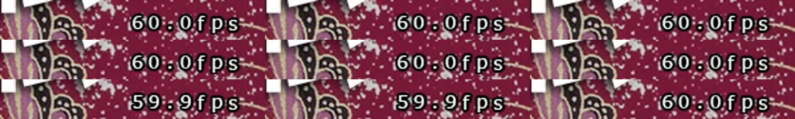

# フェーズ93: th15の低速録画で画面上のfps表示を等倍換算にする

日付: 2026-11-04

## 背景

reports/91でth15のCPU低速録画を採用したが、配信版の画面右下に低速のままの値(1/2倍速で「30.0fps」)が残ることをユーザーが視聴で確認した。他タイトル(reports/48・64・69・90)と同じく等倍換算で表示されるようにする。

## 調査

```bash
python3 scripts/90_find_fps_timer_callsites.py games/th15/th15.exe
python3 scripts/90_find_fps_timer_callsites.py games/th15/th15.exe --disasm 0x72c90 0x72dc4
```

| RVA | 内容 |
|---|---|
| `0x33767` | fps書式文字列`%2.1ffps`の`push`。関数`0x336e0`が`[ecx+0x30]`の値を描画する |
| `0x335f0` | `FPSInf`の更新。`call 0x72c90`(戻り先`0x33600`)の時刻と前回時刻`[esi+0x10]`の差を、フレーム数`[esi+0x1c]`で割って`[esi+0x30]`へ入れる |
| `0x72c90` | 時刻取得関数(`push ebp; mov ebp, esp`のEBPフレームあり)。QueryPerformanceCounterの戻り先は`0x72ccb` |

**`0x72c90`は32か所から呼ばれ**、`0x72602`〜`0x72bb0`などメインループの呼び出しも含む。th15はQPCのビジーポーリングでフレームレートを制御するので(reports/85)、他タイトルと同じくQPCの戻り先だけで偽装すると、フレームペーシングまで巻き込む恐れがある(th20の全呼び出し元の偽装はハングした、reports/48)。

## 実装

`mods/common/fps_display_hook`に`InstallFpsDisplayCorrectionHookViaCaller(qpcReturnRva, callerReturnRva)`を追加した。QPCの戻り先に加え、`__builtin_frame_address(0)`から辿った保存EBPの+4(時刻取得関数の戻り先)も一致するときだけ偽装する。スタックを読むのはQPCの戻り先が一致したときだけなので、EBPフレームを持たない関数のスタックは読まない。

```cpp
InstallFpsDisplayCorrectionHookViaCaller(0x00072ccb, 0x00033600);  // th15
```

倍率は既存の`ComputeDisplayScale()`のとおり`FPS_LIMIT_TARGET_HZ/60/SPEED_HACK_MULTIPLIER`で、**等倍と倍速(2倍速なら120/60/2)では1.0となり偽装しない**。呼び出しは`InstallSpeedHackHook()`の後(IATの外側)に置いた。

`mods/th15_replay_autoplay/build_mingw.sh`のソース一覧に`fps_display_hook.cpp`を追加。

## 検証(ローカル、Xvfb・`LIBGL_ALWAYS_SOFTWARE=1`)

`scripts/25`を直接実行した(`scripts/91_run_slowmo_batch.sh`はPulseAudioをmaskするのでローカルでは使わない)。リプレイは`th15_09.rpy`(Extra)。

```bash
FPS_LIMIT_TARGET_HZ=30 python3 scripts/25_record_replay_e2e_multigame.py --game th15 --replay th15_09.rpy \
  --cpu-display --record-seconds 110 --max-duplicate-rate 95 --output <出力先>
```

| 条件 | 補正倍率(MODログ) | FpsMonitor | 画面のfps表示(録画の60%・75%・90%地点) |
|---|---|---|---|
| 30Hz | 0.5000 | 30.0Hz | 60.0 / 60.0 / 60.0 |
| 20Hz | 0.3333 | 20.0Hz | 60.0 / 60.0 / 60.0 |
| 等倍 | 1.0000 | 59.9Hz | 59.9 / 59.9 / 60.0 |



上から30Hz・20Hz・等倍。FpsMonitorは目標どおりで、ゲームの進行速度は変わっていない。

**完走の確認**: 30Hzで最後まで録画し(357.9秒、試行1回目で成功、同期マーカーの残差-0.2ms)、スコアが記録と一致した(MODログの内部値1710121×10=17101210)。fpsの最低は27.3Hz。

処理落ち時に表示が下がること(例: 実測25Hzで50fps前後)は、計算式から正しいはずだが、今回の短尺では目視で確認していない。

## 未実施

- AWS実機での確認
- 2倍速の実機確認(倍率1.0で偽装しないことは計算と等倍の結果からの判断)
- 高負荷区間の表示の目視
- 本番(sattori-dev `worker/mods`)への移植(hakatashi/sattori-dev#316)。`th15.exe`のバイナリが変わるとRVAも変わる。一致しなければ補正されないだけで、実害は無い

## 成果物

`/mnt/cache3/sattori-th15-verify/phase93_fps_display/out/`: `fps_{30,20,60}hz.mp4`、`full_30hz.mp4`、各ログ、`th15_hook.dll`(このビルド)

## 変更ファイル

`mods/common/fps_display_hook.cpp`・`.h`、`mods/th15_replay_autoplay/dllmain.cpp`・`build_mingw.sh`、`docs/titles/th15.md`、`docs/known-limitations.md`、`reports/91_phase91_cpu_slowmo_reverification.md`、`reports/README.md`、`AGENTS.md`
